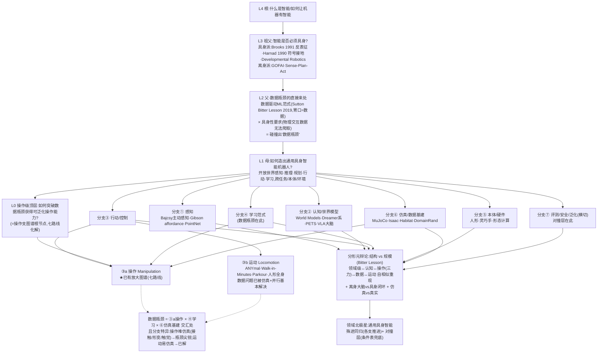

# 具身智能机器人 · 领域级研究路径图谱(更大视角)· v0.1(骨干稿 / draft,未签发)

**性质**:G3 里程碑④ 关联的**领域级综述图谱**(黄色产物,草稿制)。
**版本**:v0.1 **骨干稿**;**未走会签前自查复核、未签发、不入 `final/`**。
**起草**:Dexter,2026-10-14(主会话推理架构 + 1 路异路径子 agent 核实领域级奠基锚点 venue)。
**触发**:委托人 2026-10-14 指令——"科学问题:如何突破数据瓶颈获得可泛化操作能力?
**这个问题从何而来**,再往上和水平查找研究路径,整理**具身智能机器人这个研究领域的
更大视角的研究路径图**"。
**与既有产物关系**:本件是 `领域科研路径图谱-v0.1.md`(操作级,顶层瓶颈=数据瓶颈)的
**向上扩展**——把"数据瓶颈"从根节点降为**一个派生问题**,追溯它的来处,并在
**整个具身智能机器人领域**的尺度上水平展开。**操作级图谱是本图"行动/控制 × 学习范式 ×
数据基建"交汇处的一个放大切片**(zoom-in),不推翻、是被包含。

---

## TL;DR

- **"数据瓶颈"不是根问题,它有一个明确的来处**:它是**两股历史力量碰撞**的产物——
  ①**数据驱动的 ML 范式**(深度学习靠互联网级数据+规模+通用学习取胜;Sutton《The Bitter
  Lesson》2019:能利用算力的通用方法最终最有效)的**胃口是数据**;②**具身性要求**
  (Brooks 1991 反表征 / Harnad 1990 符号接地:智能须接地到感觉运动经验)决定
  **物理交互数据无法从互联网爬取**。**把"胃口是数据"的范式应用到"数据无法廉价生成"
  的具身操作,就撞出了"数据瓶颈"这个问题。**
- **向上谱系(L0→L4)**:数据瓶颈(L0,操作)← 通用具身智能(L1)← [数据驱动范式 ×
  具身性 的碰撞](L2,L0 的直接来处)← 智能是否必须具身(L3,AI 根本分歧)←
  什么是智能(L4,AI 总问题;具身智能是其"物理接地"分支)。
- **领域级水平分支(七支)**:①感知 ②认知/世界模型/推理规划 ③行动/控制(含**操作**
  与**运动**两大子支)④学习范式 ⑤本体/硬件 ⑥仿真/数据基建 ⑦评测/安全/泛化(横切)。
  **操作数据瓶颈 = ③行动(操作)× ④学习范式(数据引擎)× ⑥仿真数据基建 的交汇处。**
- **一个关键洞察(解释"为什么操作有数据瓶颈、运动没有")**:**数据瓶颈是分支特异的**——
  **运动控制(locomotion)的数据问题已被"刚体仿真 + 大规模并行"基本解决**(Rudin CoRL 2021
  "分钟级学会行走":数千环境 GPU 并行,刚体动力学仿真保真度高);**操作(manipulation)
  没有**——因为接触富集、形变、触觉**难以仿真**(sim2real gap 大),数据只能真机采。
  **所以"数据瓶颈"文献集中在操作支,不是偶然,是物理决定的。**
- **分形元辩论(贯穿每一层)**:**结构 vs 规模**(Bitter Lesson 之争)在领域级、操作级、
  数据级、运动级**自相似地重现**——这是整张图的深层骨架(见 §4)。

---

## §0 范围·方法·证据纪律

- **范围**:**整个具身智能机器人领域**(不只操作)——感知/认知/行动/学习/本体/仿真/评测。
  **操作支已有放大图谱**(`领域科研路径图谱-v0.1.md` + Phase 2 路线④⑤深挖),本件其余六支
  为**领域级骨干**(有 venue 已核奠基锚点,但**未逐支深挖到操作支那种深度**)。
- **时间窗**:**1986-2026**(回溯到行为主义/符号接地的思想源头;操作支图谱是 2021-2026)。
- **venue 纪律**:奠基锚点的出处**经子 agent 核实**(DOI/出版商/会议论文集页/arXiv comment),
  核不到标"未核实",绝不编造;**书/博客/技术报告与论文体例不同,分别标注**。
- **置信度分层**:思想史锚点(Brooks/Harnad/Sutton/Gibson)= 高(DOI/官方页已核);
  领域分支结构 = 判断(本件原创组织,标注);操作支细节 = 高(已有放大图谱);
  其余六支的代表作覆盖 = 中(骨干级,未穷尽)。

---

## §1 "数据瓶颈"问题从何而来(向上追溯谱系链)

**这是委托人问题的核心。"如何突破数据瓶颈获得可泛化操作能力"不是凭空出现的,
它有清晰的五层来处:**

### L4(根)· 什么是智能 / 如何让机器有智能
AI 的总问题。具身智能机器人是它的**"物理接地"分支**——主张智能不能只在符号/数字世界里,
必须在与物理世界的交互中实现。

### L3(祖父)· 智能是否必须具身?(AI 的根本分歧)
- **一方(离身/符号主义)**:GOFAI、Sense-Plan-Act——智能 = 符号推理,可脱离身体。
- **另一方(具身/行为主义)**:
  - **Brooks "Intelligence without representation"**(1991,*Artificial Intelligence* 47:139-159,
    DOI 10.1016/0004-3702(91)90053-M):智能体**无需环境的显式内部符号表征**,行为由与环境
    直接交互分层组织产生;其技术原型 = **subsumption architecture**(Brooks 1986,*IEEE JRA* 2:14-23,
    DOI 10.1109/JRA.1986.1087032)。
  - **Harnad "The Symbol Grounding Problem"**(1990,*Physica D* 42:335-346,
    DOI 10.1016/0167-2789(90)90087-6):符号系统的意义不能仅由其他符号解释,**必须接地到
    感觉运动经验**。
  - **Developmental robotics**(Lungarella et al. 2003 综述,*Connection Science* 15:151-190,
    DOI 10.1080/09540090310001655110):机器人应在与环境长期交互中**自主发展**感知运动能力。
- **具身智能机器人这个领域 = "智能必须具身"这一支的工程化**。**数据瓶颈是这一支的内在代价**
  ——因为要接地到物理交互,而物理交互数据昂贵。

### L2(父·数据瓶颈的直接来处)· 数据驱动 ML 范式 × 具身性要求 的碰撞
**数据瓶颈问题是这两股力量碰撞的产物:**
- **力量 A:数据驱动的 ML 范式**。深度学习在视觉(ImageNet)、语言(互联网文本)取胜,
  靠的是**互联网级数据 + 规模 + 通用学习方法**。**Sutton "The Bitter Lesson"(2019,
  incompleteideas.net 博客,无 DOI/无同行评审)**:"70 年 AI 研究最大的教训是,能利用算力的
  通用方法最终最有效,而且优势巨大"——即**押注规模与通用学习,而非人工结构**。
  **这个范式的胃口是数据。**
- **力量 B:具身性要求**(承 L3)。智能须与物理世界闭环交互;而**物理交互数据无法从
  互联网爬取**——每条操作数据都要机器人**物理地动**(teleoperation/演示),慢、贵、绑定本体。
  **操作没有 ImageNet,没有互联网级语料。**
- **碰撞 → 数据瓶颈**:把"胃口是数据"的范式(A)应用到"数据无法廉价生成"的具身操作(B),
  **就撞出了"如何突破数据瓶颈"这个问题**。**所以数据瓶颈 = 数据驱动范式的胃口 × 物理世界
  数据稀缺 的交点。它不是操作领域固有的,是"用 ML 范式做具身操作"这个选择带来的。**

### L1(母)· 如何造出有通用具身智能的机器人?
在开放物理世界中感知/推理/规划/行动/学习,跨任务/本体/环境,达到或超过人类能力。
**数据瓶颈是达成它的众多障碍之一(在操作这一支最尖锐)。**

### L0(操作级图谱的顶层)· 如何突破数据瓶颈获得可泛化操作能力?
= 操作级图谱(`领域科研路径图谱-v0.1.md`)的根节点。**七条路线(规模/合成/人类数据/
结构检索/agentic/翻新/触觉)是对 L2 碰撞的七种化解**:把数据做大(①②)、借来(③)、
少要(④⑤⑥)、让每条更值(⑦)。

**谱系链一句话**:**数据瓶颈(L0)是"用数据驱动 ML 范式做具身操作"这一选择(L2)的代价,
该选择源于"智能必须具身"的立场(L3),后者是"什么是智能"(L4)的一个分支。**

---

## §2 领域级水平分支(整个具身智能机器人的研究路径)

**在 L1(通用具身智能)之下,领域水平展开为七支**(组织判断,这是判断,置信度中):

> **⚠️ Phase 2 深挖更新(2026-10-14)**:**分支②(认知/世界模型)与分支③b(运动)已深挖**到
> 子分支 + 全文级锚点 + venue 核实 + 演进/分歧/开放问题,见
> `reports/drafts/领域科研路径图谱-Phase2-分支②③b深挖-v0.1.md`。下方 §2 各分支仍是 Phase 1
> 骨干级(奠基锚点),**②与③b 以 Phase 2 深挖件为准**。**Phase 2 核出的关键回流**:
> ① **分支②→③a 衔接厘清**:②a 世界模型 → ②e 视触 WAM(DexTacWAM/VT-WAM/TacWAM/Rolling-WAM)→
> 操作支路线④;②c LLM 规划与操作支路线⑤(agentic)的边界 = "②是想的过程,⑤是把想的结果固化成
> 可复用资产",在 CaP/ProgPrompt/SayCan 处重合。**RT-2 全文 Sec5 一手证据:web 预训练只提升语义/
> 视觉泛化,机器人不获得新运动能力**——②b 的"认知"无法打破③的"运动数据瓶颈"(强化 §1 L2 谱系链)。
> ② **分支③b 假设检验修正了本件 §3**(运动数据瓶颈是"转移非消失"、光谱非二元、非纯物理决定)。
> ③ **venue 冲突已一手核定(2026-10-15,Phase 2 ①⑤⑥⑦ 子 agent 查官方论文集定论)**:
> **Isaac Gym(2108.10470)= NeurIPS 2021 Datasets & Benchmarks Track(Round 2),确证(高)**——
> 依据 nips.cc 官方录用列表 + OpenReview id=`fgFBtYgJQX_`(venueid=NeurIPS.cc/2021/Track/Datasets_and_Benchmarks/Round2);
> 先前"未核实"错在**只查 arXiv**(comment 仅 "tech report"、无 journal_ref)。**HumanPlus(2406.10454)= CoRL 2024,
> 确证(高)**——依据 PMLR v270 fu25a(pp.2828-2844)+ Best Paper Finalist;arXiv comment 仅 "project website" 故单查 arXiv 会误判。
> **⚠️ 可复用教训(已录 lessons):arXiv comment ≠ venue**——NeurIPS D&B/CoRL 录用常不在 arXiv comment/journal_ref,
> 须查官方论文集(nips.cc/PMLR/proceedings.mlr.press/roboticsproceedings.org/OpenReview),不得以 arXiv 无 journal_ref 推定"未核实"。
> **Domain Randomization(1703.06907)= IROS 2017**(Crossref DOI 10.1109/iros.2017.8202133 确证录用,arXiv comment 仅"submitted")。
> ④ **Phase 2 升级/补准**:ExBody=RSS 2024(Crossref,升 high)、DreamerV2=ICLR 2021(comment 实证,升)、
> World Models ⚠️ 双题名/双 ID(1803.10122 预印本 / 1809.01999 NeurIPS 正式版《Recurrent World Models
> Facilitate Policy Evolution》)、Lee ANYmal=2010.11251、Miki=2201.08117、Walk These Ways=2212.03238、
> Humanoid Next-Token=2402.19469(NeurIPS 2024)。
> ⑤ **✅ 剩余四支(①感知/⑤本体/⑥仿真基建/⑦评测)已于 2026-10-15 深挖完成**,见
> `reports/drafts/领域科研路径图谱-Phase2-分支①⑤⑥⑦深挖-v0.1.md`——**至此领域级七分支(①②③a③b④⑤⑥⑦)
> 全部深挖**(记分卡 79/96,见该件 §0)。**两项结构性发现**:(a)**分支⑦:对撞层成员发表状态分层——
> RoboArena 已正式发表(CoRL 2025 Oral,PMLR 305:336-364);vla-eval 仅 ICRA 2026 Workshop Poster(非主会);
> 其余成员(RoboDojo/BiGym 2.0/LIBERO-PRO/SafeVLA-Bench 等)venue 未逐一核实**——⚠️ 原写"整个对撞层无一经
> 同行评审正式发表、全部预印本/技术报告"的**全称断言已被 N3 证伪并撤回**(2026-10-15 Round 2 权威性检验;
> 见本件 §8.5 #9、Phase2-分支①⑤⑥⑦ §2.3);收缩后的方向性论断为「**发表滞后于事实权威**」(RoboArena
> 2025-06 上 arXiv、2025-11 出 v2、CoRL 2025 才正式发表;vla-eval 至今只有工作坊位)——**这是判断,置信度中**
> (仅 RoboArena/vla-eval 两例支撑,不得再作全称断言);(b)**分支①:MT3 位姿估计上游是
> CoRL 2023 回归+Generalized-ICP,不是 FoundationPose 谱系**→"FoundationPose 作可替换但未被采用的候选"是明确研究缺口。
> **唯一全支共缺 = 权威性检验(≥3 处跨源定案)+ 会签前自查复核 → 合并签发 v1.0(Round 2)。**

### 分支① 感知(Perception)——理解世界
- **核心问题**:机器人如何从传感器理解世界(物体/场景/位姿/可供性/主动感知)?
- **奠基锚点(venue 已核)**:**Bajcsy "Active Perception"**(1988,*Proc. IEEE* 76:966-1005,
  DOI 10.1109/5.5968;感知是有目的、任务驱动的主动过程)、**Gibson《The Ecological Approach
  to Visual Perception》**(1979,Houghton Mifflin 专著;affordance=环境提供的行动可能性,
  直接知觉)、**PointNet**(Qi et al.,arXiv:1612.00593,**CVPR 2017**;无序点云直接输入)、
  **Aksoy et al.**(物体-动作关系语义,*IJRR* 2011,DOI 10.1177/0278364911410459)。
- **与操作支的关系**:操作图谱**把感知当给定**(MT3 用 Grounding DINO+XMem 分割、位姿估计);
  感知支是操作支的**上游**。

### 分支② 认知 / 世界模型 / 推理规划(Cognition)——"大脑"
- **核心问题**:机器人如何预测行动后果、规划任务、推理、记忆?
- **奠基锚点(venue 已核)**:**Ha & Schmidhuber "World Models"**(arXiv:1803.10122,
  **NeurIPS 2018**,⚠️ 官方题名 *Recurrent World Models Facilitate Policy Evolution*;
  生成式 RNN 压缩环境表征,策略可在"想象"中训练)、**Dreamer 系**(Dream to Control
  arXiv:1912.01603,ICLR 2020[置信度中];DreamerV2 arXiv:2010.02193,ICLR 2021[置信度低,
  仅作者自述];**DreamerV3** arXiv:2301.04104,**Nature** 2025,DOI 10.1038/s41586-025-08744-2,
  ⚠️ 官方题名 *Mastering diverse control tasks through world models*)、**PETS**(Chua et al.,
  arXiv:1805.12114,**NeurIPS 2018**;概率集成动力学+轨迹采样规划)、**Model-based RL 综述**
  (Moerland et al.,*FnT in ML* 2023,DOI 10.1561/2200000086)。
- **与操作支的关系**:操作图谱的**路线⑤(agentic/VLA 认知)与路线④的世界模型(WAM 系)
  是这一支在操作上的落地**;VLA(π0/RT-2)既是"行动策略"也是"认知大脑",跨②③。

### 分支③ 行动 / 控制(Action/Control)——产生运动(**操作支在此**)
- **核心问题**:机器人如何产生运动?分两大子支:
  - **③a 操作(Manipulation)**:**已有放大图谱**(`领域科研路径图谱-v0.1.md` 七路线 +
    Phase 2 路线④⑤深挖)。锚点见该件(RT-1/RT-2/π0/MT3/STRAP/...)。
    **⚠️ 此处 STRAP = arXiv:2412.15182**(子轨迹检索,**ICLR 2025 Poster**);**它与 MT3 的参考文献
    [46](= Vitiello et al. "One-Shot Imitation Learning: A Pose Estimation Perspective",CoRL 2023,
    PMLR 229:943-970,arXiv:2310.12077)不是同一篇论文**——两者不可互换、不可共用"STRAP"标签,
    ID↔归属定案见本件 §8.5 表 **#11(N6)/ #12(N7)**。
  - **③b 运动(Locomotion)**:足式/四足/双足/人形行走、越障、全身控制。
    **奠基锚点(venue 已核)**:**Hwangbo et al. ANYmal**(2019,*Science Robotics* 4:eaau5872,
    DOI 10.1126/scirobotics.aau5872;仿真 RL 训敏捷动态技能迁真机)、**Rudin et al.
    "Learning to Walk in Minutes"**(arXiv:2109.11978,**CoRL 2021**,PMLR 164;数千环境
    GPU 并行,行走训练压到分钟级)、**Lee et al. ANYmal**(2020,*Science Robotics* 5:eabc5986,
    DOI 10.1126/scirobotics.abc5986;教师-学生,无先验地图崎岖地形)、**Robot Parkour**
    (Zhuang et al.,arXiv:2309.05665,**CoRL 2023 Oral**,PMLR 229)、**Extreme Parkour**
    (Cheng et al.,arXiv:2309.14341,**ICRA 2024**)、**Expressive Whole-Body Control(人形)**
    (arXiv:2402.16796,**RSS 2024**,DOI 10.15607/RSS.2024.XX.107[venue 单源 Crossref,置信度中])。
- **关键洞察(见 §3)**:**③b 运动的数据问题已被仿真+并行基本解决,③a 操作没有**——
  这是数据瓶颈为何集中在操作支的物理原因。

### 分支④ 学习范式(Learning Paradigm)——技能如何获得(**数据瓶颈在此**)
- **核心问题**:机器人如何获得技能?模仿/遥操作、RL(model-free/model-based)、自监督、
  sim2real、**数据引擎**。
- **与操作支的关系**:**操作级图谱的七条路线(规模/合成/人类数据/结构检索/agentic/翻新/触觉)
  就是这一支在操作上的具体展开**。**数据瓶颈问题(L0)正住在这一支与③⑥的交汇处。**
- **领域级视角**:学习范式之争 = **结构 vs 规模**(Bitter Lesson)的具体化(见 §4)。

### 分支⑤ 本体 / 硬件(Embodiment/Hardware)——身体本身是研究对象
- **核心问题**:什么形态的身体?人形/机械臂/灵巧手/四足/移动底盘;灵巧手、软体/柔顺、
  形态计算(morphological computation)、身体-控制协同设计。
- **现状(判断)**:2024-2026 人形机器人浪(Tesla Optimus/Figure/Unitree/Agility 产业 +
  全身控制学术,如 RSS 2024 Expressive Whole-Body Control);灵巧手是操作支的硬件前沿。
- **与操作支的关系**:操作图谱的硬件(Sawyer/Realman/柔性夹爪/灵巧手)是这一支的实例;
  **本体差异是跨本体迁移(操作图谱路线④缺口③)的根源**。

### 分支⑥ 仿真 / 数据基建(Sim/Data Infrastructure)——"母体"
- **核心问题**:在哪造数据?仿真器、合成数据、数字孪生、数据集、基准、sim2real gap。
- **奠基锚点(venue 已核)**:**MuJoCo**(Todorov et al.,**IROS 2012**,DOI 10.1109/IROS.2012.6386109;
  凸优化+广义坐标的快接触物理引擎)、**Isaac Gym**(arXiv:2108.10470,**NeurIPS 2021 D&B**;
  GPU 并行物理,快 2-3 数量级)、**Habitat**(Savva et al.,arXiv:1904.01201,**ICCV 2019**;
  高性能 3D 具身仿真平台)、**Matterport3D**(Chang et al.,arXiv:1709.06158,**3DV 2017**;
  10,567 RGB-D 全景真实室内场景)、**Domain Randomization**(Tobin et al.,arXiv:1703.06907,
  **IROS 2017**;仅随机化仿真外观即可零样本迁真机)、**Sim2Real 综述**(Zhao et al.,
  arXiv:2009.13303,**SSCI 2020**[⚠️ venue 更正:非 WACV 2021])。
- **与操作支的关系**:操作图谱的**路线②(合成)整支住在这里**;仿真保真度(接触/形变/触觉)
  是操作数据瓶颈能否靠合成化解的关键约束。

### 分支⑦ 评测 / 安全 / 泛化(Evaluation/Safety/Generalization,横切)
- **核心问题**:怎么知道进步了?基准、鲁棒性、安全、泛化理论、可复现/可比性。
- **锚点(操作支已核)**:LIBERO/LIBERO-PRO/LIBERO-Plus、RoboDojo、RoboCasa365、BiGym 2.0、
  vla-eval、RoboArena(详见操作支图谱与对撞层证据)。
- **与操作支的关系**:**委托人裁决保留的"对撞层"住在这里**;评测口径不统一/对撞缺席是
  领域级方法论缺口(不止操作)。

---

## §3 关键洞察:数据瓶颈是"分支特异"的(解释操作 vs 运动的不对称)

> **⚠️ v0.1 修正(2026-10-14,Phase 2 假设检验后)**:本节初稿曾断言"运动数据问题**已基本解决**、
> 操作**未解决**、**物理决定**"。经分支③b 全文级假设检验(Rudin/Robot Parkour/ExBody 三篇读全文,
> 详见 `领域科研路径图谱-Phase2-分支②③b深挖-v0.1.md` §2.5),**该判断只部分成立、且说得太满**,
> 据实修正如下(**保留真实非对称,修正"已解决/纯物理决定"的过强表述**)。

**为什么"数据瓶颈"文献集中在操作支,运动支却相对少?——非对称真实存在,但是光谱而非二元(判断,置信度中-高;经全文级证据检验):**

| | 运动控制(③b) | 操作(③a) |
|---|---|---|
| 数据能否廉价仿真生成? | **部分能**——刚体腿-地接触仿真保真度高,但**执行器动力学难仿真**(Rudin:ANYmal 串联弹性执行器 "hard to model in simulation",需真实电机数据辨识 actuator net) | **难**——接触富集、形变、触觉,sim2real gap 大 |
| 数据问题现状 | **在"四足+结构化地形+行走"子域已大幅缓解**(Rudin CoRL 2021 分钟级,数千环境 GPU 并行),**但非"已解决"**:parkour 需手工建仿真环境(Robot Parkour Sec5 "requires the simulation environments to be manually constructed")、人形依赖真实 MoCap(ExBody CMU MoCap ~780 段)、感知敏捷/长时鲁棒/动态扰动仍开放 | **未解决**:每条数据要真机采(MT3 单机 17h 才 1000 任务);Rudin Sec1 一手对比"OpenAI 方块重定向训 14 天、魔方数月 vs 运动 <20 分钟" |
| 主导范式 | 仿真大规模并行 RL(sim2real)+ **真实数据组件**(执行器辨识/人类 MoCap/手工场景) | 七路线混战(规模/合成/人演/检索/agentic/翻新/触觉) |
| 数据瓶颈尖锐度 | **中(且是"转移"非"消失")**——从"动力学/轨迹数据"转到"环境多样性 + 真实执行器/人类动作先验" | **高** |

**修正后的推论**:
1. **非对称真实存在**(高置信):操作(接触富集/形变/触觉)的 reality gap 明显大于运动(刚体腿-地),
   这是"数据瓶颈"文献集中在操作支的**主要原因**——Rudin Sec1 的"14 天/数月 vs <20 分钟"是一手旁证。
2. **但"运动已解决"被夸大**(中置信):只在四足/结构化地形/行走子域成立;parkour/人形/感知敏捷/
   长时鲁棒均未解决。**运动的数据瓶颈是"转移"而非"消失"**——从动力学数据转到环境多样性 +
   真实执行器辨识 + 人类动作先验。
3. **且"纯物理决定"不准确**(中置信):运动仍有**真实数据入口**(actuator net 需真实电机数据、
   人形需 CMU MoCap、parkour 需手工建场景/未来靠真实数据)——不是"刚体仿真即可"。
4. **二者是光谱,不是"已解决/未解决"的二元**;操作在光谱的"重数据瓶颈"端,运动在"轻(但未消除)"端。
5. **杠杆点仍成立**:操作支路线②(合成)受限于接触/形变/触觉的仿真保真度;**若仿真的接触物理
   保真度突破,操作数据瓶颈会大幅缓解**——这是分支⑥(仿真基建)对分支③a(操作)④(学习)的杠杆点。
6. **盲区(诚实)**:未找到直接对比 locomotion vs manipulation 数据需求的权威单篇文献;
   "物理决定论"框架缺一手对照实验支撑——本判断更多是社区共识 + Rudin Sec1 旁证,非受控实证。

---

## §4 分形元辩论:结构 vs 规模(贯穿每一层的深层骨架)

**整张图最深层的组织原则,是一场在每一尺度自相似重现的辩论(判断,置信度中-高):**

**领域级(L3/L4)**:**结构 vs 规模**——
- 结构派:Sense-Plan-Act、model-based、世界模型、符号规划(押注"建对结构")。
- 规模派:Bitter Lesson(Sutton 2019)、深度 RL、VLA(押注"规模+通用学习胜过人工结构")。

**这场辩论在每一层重现(分形)**:
- **认知支(②)**:model-based/世界模型(结构)vs model-free 大规模 RL(规模)。
- **操作支(③a)**:**端到端 VLA(规模)vs 分层/检索/agentic(结构)**——即操作图谱的"三力"
  (端到端/分层/agentic),**是领域级"结构 vs 规模"在操作上的局部实例**。
- **数据支(④)**:采更多/造更多(规模)vs 少要数据靠结构先验/检索/外化资产(结构)——
  即操作图谱七路线的分野。
- **运动支(③b)**:大规模并行仿真 RL(规模,Rudin)vs model-based/结构化控制(结构)。

**另两场领域级辩论(同样贯穿)**:
- **离身大脑 vs 具身闭环**:VLA/VLM 当"可分离的大脑"(离身倾向)vs 智能必须与物理闭环
  (Brooks/Harnad 具身立场)。2026 的"harness 包冻结 VLA"(操作图谱路线⑤c)是前者;
  触觉/力反馈闭环(路线⑦/④e)是后者。
- **仿真 vs 真实**:在哪学智能?sim2real gap(分支⑥)是这场辩论的战场;运动支选了"仿真为主",
  操作支因接触保真度被迫"真机为主+仿真辅助"。

**§4 小结**:**操作级图谱的"三力对撞/殊途同归"不是操作支特有的,是领域级"结构 vs 规模"
元辩论的局部投影。** 委托人 2026-10-13 裁决的"殊途同归+一个对撞层",在领域级同样成立:
结构派与规模派各自推进(殊途同归),但"什么任务该用结构还是规模"的条件表需要同口径对撞。

---

## §5 可视化图谱(mermaid)

> 独立可渲染文件见 `reports/drafts/具身智能领域级图谱-v0.1.mermaid`。下方为同一图源码。

---

## §6 操作支图谱在本图中的定位(zoom-in 接口)

**本图是"更大视角";操作支是它的一个放大切片。** 接口:
- **L0(数据瓶颈)= 操作支图谱的根节点**(`领域科研路径图谱-v0.1.md` §1)。
- **操作支七路线 = 本图分支④(学习范式)在操作上的展开**;其中路线②(合成)跨分支⑥,
  路线⑤(agentic)跨分支②,路线⑦(触觉)跨分支①⑤。
- **操作支的"三力对撞/殊途同归" = 本图 §4 分形元辩论(结构 vs 规模)的操作级投影。**
- **Phase 2 深挖的路线④⑤ = 本图分支③a×④ 与 ③a×② 的细部。**

**向下 zoom-in 链**:本图(领域)→ 操作支图谱(七路线)→ Phase 2(路线④⑤子分支)→
具体论文(MT3/STRAP/WAA/...)。
**⚠️ ID 护栏**:此处 **STRAP = 2412.15182(ICLR 2025 Poster,子轨迹检索)**,**不是** MT3 的参考文献
**[46] = 2310.12077(Vitiello et al., CoRL 2023, PMLR 229:943-970,位姿估计)**;二者并列出现时尤须分清,
定案见 §8.5 表 #11/#12。

---

## §7 分歧与开放问题(领域级)

- **元分歧:结构 vs 规模**(§4)——Bitter Lesson 是否适用于具身?操作的七路线混战
  尚无定论;运动支规模派(并行仿真 RL)阶段性胜出,操作支未定。
- **离身大脑 vs 具身闭环**——VLA 当可分离大脑能走多远?触觉/力闭环是否必需?
  (操作支路线⑦/④e 的开放问题在此上升为领域级。)
- **仿真 vs 真实**——接触/形变/触觉的仿真保真度能否突破?若能,操作数据瓶颈大幅缓解
  (§3 杠杆点);若不能,操作长期依赖真机数据。
- **评测/可比性危机**(分支⑦)——不止操作:领域级缺同口径对撞,数字失去指称
  (操作支已实证:LIBERO-PRO 90%→0.0%、PhysEvo 62% vs RoboDojo 8.80%)。
- **本体泛化**——跨本体(⑤)迁移是否可能?操作的跨本体免训练检索仍开着
  (操作支路线④缺口③);领域级"一个大脑驱动多种身体"是北极星之一。

---

## §8 语料清单 / 回指表(领域级奠基锚点,venue 已核优先)

**思想史/谱系(venue 已核)**:Brooks 1991(*Artificial Intelligence*,DOI 10.1016/0004-3702(91)90053-M)、
Brooks 1986 subsumption(*IEEE JRA*,DOI 10.1109/JRA.1986.1087032)、Harnad 1990(*Physica D*,
DOI 10.1016/0167-2789(90)90087-6)、Sutton 2019 Bitter Lesson(incompleteideas.net 博客,无 DOI)、
Lungarella 2003 developmental robotics(*Connection Science*,DOI 10.1080/09540090310001655110)、
Gibson 1979 affordance(Houghton Mifflin 专著)、Bajcsy 1988 Active Perception(*Proc. IEEE*,DOI 10.1109/5.5968)。

**认知/世界模型(venue 已核)**:Ha & Schmidhuber World Models(arXiv:1803.10122,NeurIPS 2018,
⚠️ 官方题名 *Recurrent World Models Facilitate Policy Evolution*)、PETS(arXiv:1805.12114,NeurIPS 2018)、
DreamerV3(arXiv:2301.04104,Nature 2025,DOI 10.1038/s41586-025-08744-2,⚠️ 官方题名 *Mastering
diverse control tasks through world models*)、Model-based RL 综述(Moerland,*FnT ML* 2023,DOI 10.1561/2200000086)。
**venue 置信度中/低**:Dream to Control(arXiv:1912.01603,ICLR 2020[中])、DreamerV2(arXiv:2010.02193,ICLR 2021[低,仅作者自述])。

**行动/运动(venue 已核)**:Hwangbo ANYmal(*Science Robotics* 2019,DOI 10.1126/scirobotics.aau5872)、
Rudin Walk-in-Minutes(arXiv:2109.11978,CoRL 2021,PMLR 164)、Lee ANYmal(*Science Robotics* 2020,
DOI 10.1126/scirobotics.abc5986)、Robot Parkour(arXiv:2309.05665,CoRL 2023 Oral,PMLR 229)、
Extreme Parkour(arXiv:2309.14341,ICRA 2024)、Expressive Whole-Body Control(arXiv:2402.16796,RSS 2024,
DOI 10.15607/RSS.2024.XX.107[venue 单源,中])。

**感知/导航(venue 已核)**:PointNet(arXiv:1612.00593,CVPR 2017)、Aksoy object-action(*IJRR* 2011,
DOI 10.1177/0278364911410459)、Habitat(arXiv:1904.01201,ICCV 2019)、Matterport3D(arXiv:1709.06158,3DV 2017)。

**仿真/数据基建(venue 已核)**:MuJoCo(*IROS* 2012,DOI 10.1109/IROS.2012.6386109)、Isaac Gym
(arXiv:2108.10470,NeurIPS 2021 D&B)、Domain Randomization(arXiv:1703.06907,IROS 2017)、
Sim2Real 综述(arXiv:2009.13303,SSCI 2020[⚠️ venue 更正:非 WACV 2021])。

**操作支(回指,不重列)**:见 `领域科研路径图谱-v0.1.md` §8(venue 已核 30+ 篇)+
`领域科研路径图谱-Phase2-路线④⑤深挖-v0.1.md`。

**⚠️ 负面证据(勿误引,子 agent 核出)**:ObjectNav Revisited(arXiv:2006.13171)**不是 CVPR 2021**
(扫 CVPR 2021 全量 1660 条 0 命中 Batra/ObjectNav;按 arXiv 预印本引,或用 Habitat ICCV 2019 作
ObjectNav 谱系锚点);On Evaluation of Embodied Navigation Agents(arXiv:1807.06757)= 工作组技术报告,
无正式论文集;SPA 范式无单一奠基文献(Shakey SRI TN 323 无 DOI,建议引 Brooks 1991 内的对立论述);
"the world is its own best model" 常归 Brooks 1991 但**原文页码未核**,引用前须补。

---

## §8.5 权威性检验(≥3 处跨源口径分歧定案;deep-read §3 签发前硬要求)

**判据**:对 ≥3 处跨源口径分歧给出定案,且**定案须引外部/原始来源**(不得只靠本地库互证)。
本图谱系列累计已定案 **12 处**(远超 ≥3),逐条列各源立场 + 外部来源 + 定案:

> **版本说明(2026-10-15 Round 2c 回流)**:**#1-#8** 为 2026-10-14/15 各轮 Phase 2 子 agent 核定;
> **#6/#7 已由 Round 2 权威性检验细化/升级**(见 **N1**/**N2**),**#9-#12 为 2026-10-15 Round 2 权威性检验
> 新增**,由**主会话 `curl` 实抓外部原始来源**核定(24 次 HTTP 200,抓取日志见
> `reports/drafts/领域级图谱-权威性检验记录-v0.1.md` §0;定案全文见该件 §2 **N1-N7**)。
> **本表 #9-#12 只登 N3/N5/N6/N7 四条**(依检验记录 §5 回流清单);**N4**(RoboArena 排名算法与策略池的
> 精确表述)已回流 `领域科研路径图谱-Phase2-分支①⑤⑥⑦深挖-v0.1.md` §2.2 RoboArena 卡,**#9 内附指引**。

| # | 分歧 | 各源立场 | 外部/原始来源 | 定案(这是判断) |
|---|---|---|---|---|
| 1 | **Isaac Gym venue** | Phase 1 子 agent:NeurIPS 2021 D&B(S2+DBLP)vs Phase 2 ②③b 子 agent:"未核实(arXiv comment 仅 tech report,Crossref 误配)" | **nips.cc 官方《NeurIPS 2021 D&B Accepted Papers》列表 + OpenReview id=`fgFBtYgJQX_`(venueid=NeurIPS.cc/2021/Track/Datasets_and_Benchmarks/Round2)** | **= NeurIPS 2021 D&B Track(Round 2),确证(高)**。"未核实"错在只查 arXiv(comment 无 journal_ref)。**教训:arXiv comment≠venue(已录 lessons.md)** |
| 2 | **HumanPlus venue** | 操作支路线③子 agent:CoRL 2024(GitHub+OpenReview)vs Phase 2 ③b 子 agent:"未核实(Crossref 误配,comment 仅网站)" | **PMLR v270(CoRL 2024 Munich)官方论文集 fu25a,pp.2828-2844 + 作者站 Best Paper Finalist(top 6)** | **= CoRL 2024,确证(高)**。arXiv comment 仅 "project website" 故单查 arXiv 会误判 |
| 3 | **DROID 任务数** | abs 页 84 vs 正文/官方页 86 | arXiv abs(84)+ 论文正文/官方页(86),综述 §5.4 已外部核 | **= 86**(abs 页 84 为孤例;论文正文口径优先)。承综述 §5.4 定案 |
| 4 | **OXE 机构/数据集数** | 论文 21 机构/60 数据集 vs 官方页"34 实验室" | 论文正文(21/60)vs 官方页(34),综述 §5.4 已外部核 | **= 21 机构/60 数据集(论文口径)**;官方页"34 实验室"不一致**须标来源**,不混用。承综述 §5.4 定案 |
| 5 | **LIBERO-Pro 总任务数** | 代码常量 Goal 300/Spatial 220/10 520/Object 280,论文未声明总数 | 论文(未声明)+ 代码常量,综述 §5.4 已外部核(v2 PDF 全文) | **= 论文未声明总数**;代码常量**不得相加冒充总数**。承综述 §5.4 定案 |
| 6 | **LIBERO-Pro 扰动维度**(2026-10-15 Round 2 · **N1** 细化) | 摘要/Introduction/§4.1/§5.1/§5.2 说"四个(正交)维度" vs Figure 6 图注/§4.3 说"五类扰动";**形式化记号声明 `k∈{O,R,L,E}`(四个)却在同节定义了第五个算子 `k=T`** | LIBERO-PRO(2510.03827**v2**)abs(HTTP 200 / 43,388 B)+ LaTeXML 全文(HTTP 200 / 127,339 B,59 个 math alttext 全保留),**2026-10-15 Round 2 主会话 `curl` 实抓**(检验记录 §2 **N1**;与 `benchmark-libero-pro.md` 2026-09-28/09-30 两次独立核实**一致无矛盾**) | **= 四个正交扰动维度(物体属性 / 初始空间构型 / 任务指令 / 环境)+ task 作第五类扰动、被显式排除在跨类组合之外**。Figure 6 图注逐字 "To ensure feasibility, **task perturbations are excluded from cross-type combinations**";§4.3 逐字 "To avoid infeasible combinations, **task-level perturbations are excluded from cross-type compositions**"。**⚠️ 本轮新增两条原文级细节**:①**形式化声明自身即"声明四维、定义五算子"**——§4.1 写 `k∈{O,R,L,E}` 却紧接枚举出第五算子 "Task perturbation ( `k=T` ) modifies the target object or action while remaining within the training distribution. The perturbed task is `T^(T)=(l,e,G^(T))`" → **`k=T` 是论文正式定义的算子(带自己的公式),不是图注口误,它与同节的 `k∈{O,R,L,E}` 自相矛盾**;②**"四维"的具体命名在论文内有四种措辞**(摘要 "manipulated objects / initial states / task instructions / environments";§4.1 "object attributes / initial spatial configurations / task instructions / environments";§5.1 "object properties / initial positions / task instructions(covering both semantic and structural variations)/ environments"——**把 task 折进 instruction 维**;§5.2 "objects / goals / spatial configurations / task sets")→ **论文未声明哪一组是权威口径,引用必须带脚注说明命名不统一**。**不得径写"五维正交"**(与摘要及 `k∈{O,R,L,E}` 冲突),**也不得径写"仅四维、无 task 扰动"**(§4.1 确实定义了 `k=T` 算子与公式,Figure 6 与 §4.3 均列五类)。**⚠️ 横向对比护栏**:LIBERO-PRO(4+1)/ LIBERO-Plus(7)/ LIBERO-VPro(12 类)**各家维度定义不同轴、不可直接比数** |
| 7 | **RoboArena episode 数**(2026-10-15 Round 2 · **N2** 由"两口径"**升级为"三口径"**) | 摘要:"more than **600** pairwise real-robot evaluation episodes" vs §1 正文:"a total of **612** pairwise comparisons" + "**4284** evaluation episodes / 4284 policy rollouts" | RoboArena(2506.18123**v2**)abs(HTTP 200 / 47,837 B)+ LaTeXML 全文(HTTP 200 / 343,748 B,236 math alttext 全保留),**2026-10-15 Round 2 主会话 `curl` 实抓**(检验记录 §2 **N2**) | **= 三口径,不是两口径**:①**612** = 成对 A/B 比较场次数(排名实验口径);②摘要的 "**more than 600**" 是 **612 的取整表述**——**"600" 不是独立数字**,引用应写"612 场成对 A/B 比较(摘要作 >600)";③**4,284** = 累计 policy rollouts,生成机制 = 每场 A/B 的 2 个策略 + 事后为 oracle 排名补评的"the remaining five policies"(§5.1 逐字 "asking evaluators to score the remaining five policies after each A/B evaluation on the same task. In total, we use 4284 evaluations to compute this oracle ranking")。**三者严禁混用**——4284 **不是**成对比较数,612/600 **不是**总 rollout 数。**⚠️ 算术闭合(本所推算,非原文直述;引用 4284=612×7 时须标『推算』)**:**612 × 7 policies = 4,284**,与原文两处措辞("the remaining five policies" + "7 generalist policies")完全自洽 → 可作"两口径同源"的硬证据。**图谱建议写法**:"RoboArena 在 7 所学术机构 / DROID 单本体上做众包 double-blind 成对评测,**612 场成对 A/B 比较(摘要作 >600)、累计 4,284 条 policy rollouts(=612×7,用于 oracle 排名)**"。**⚠️ 横向对比护栏**:任何"评测规模"比较(RoboDojo 42 仿真+18 真机 / vla-eval 2,000 episodes)**必须带口径标签**(成对场次 vs rollouts vs 文献聚合条数),否则构成"不同轴并列"(honor 2026-10-09 类型) |
| 8 | **OpenViTac 最强 WAM 值** | intro:53.3%/48.5% vs 自身 Table 2/3:37.4/29.0 | OpenViTac(2610.10384)全文级重审(2026-10-09,benchmark-openvitac.md) | **= intro 53.3/48.5 与自身 Table 矛盾,多种重算无法调和 → 不采用、不得作外部引用锚点;引 WAM 最强值以 Table 2/3(37.4/29.0)为准** |
| 9 | **RoboArena venue + 作者数**(2026-10-15 Round 2 新增 · **N3**) | Phase 2 ⑦ 子 agent:"未核实(整个对撞层无一经同行评审发表)";单查 arXiv comment(仅 "Website: …"、无 journal_ref)与 Crossref(`total-results:0`)会**维持"未发表"误判** | **两个独立外部源**:①**PMLR 官方论文集** `proceedings.mlr.press/v305/atreya25a.html`(HTTP 200 / 19,660 B,逐字 "Proceedings of The 9th Conference on Robot Learning , **PMLR 305:336-364, 2025**")+ 卷索引 `v305/`("RoboArena" 1 命中、"Atreya" 3 命中)+ 卷号对照页(v229=CoRL 2023 / v270=CoRL 2024 / **v305=CoRL 2025**);②**OpenReview** id=`cpmwi3Xwcr`(HTTP 200 / 25,699 B,`venue: **CoRL 2025 Oral**`,venueid=`robot-learning.org/CoRL/2025/Conference`,invitations 含 `Submission1011/-/**Spotlight_And_Camera_Ready**`,bibtex `@inproceedings{atreya2025roboarena,…}`)。**反证式核查**:Crossref `query.title=RoboArena&query.author=Atreya` = `"total-results":0,"items":[]`;DBLP 本轮 202/429 **未取得数据** → 交叉源缺位如实登记 | **= CoRL 2025(The 9th Conference on Robot Learning)Oral,PMLR 305:336-364, 2025;已同行评审并正式发表(置信度高)**。**连带证伪**:Phase2-分支①⑤⑥⑦ §2.3 的**全称断言「对撞层无一经同行评审正式发表」被证伪**(至少 RoboArena 一例),已按 N3 **分层重写**(RoboArena 已发表 / vla-eval 仅 ICRA 2026 Workshop Poster / 其余 8 项 venue 未逐一核实)。**⚠️ 同一全称断言亦见于本件 §2「Phase 2 深挖更新」框内 (a) 项——检验记录 §5 回流清单未列入本轮范围,标『待同步』,不在此处代改**。**附带定案 · 作者数须带版本口径**:arXiv **v2 abs = 32 人** / PMLR v305 **camera-ready = 26 人**(v2 独有 7 人、PMLR 独有 1 人,32−7+1=26 ✓;"Edward Hu/Edward S. Hu" 与 "Roberto Martin-Martin/Roberto Martín-Martín" 为同人异写已排除)→ **不得径写"32 位顶级作者"当既成事实**(该数字曾被 §2.3 用作"事实权威"论据);差异成因(v2 扩列贡献者?)= **推断,置信度低,不作断言**。**替代论断**:原「"事实上的权威"先于"正式发表"」的强形式不成立,**须收缩为「发表滞后于事实权威」**(RoboArena 2025-06 上 arXiv、2025-11 出 v2、CoRL 2025 才正式发表;vla-eval 至今只有工作坊位)——**这是判断,置信度中**(只有两例支撑)。**排名算法与策略池的精确表述见检验记录 §2 N4,已回流 Phase2-分支①⑤⑥⑦ §2.2 RoboArena 卡**(要点:BT 的任务感知扩展含 Davidson 平局项、用 EM 拟合;BT/Elo 是被击败的对比基线,**不得写"用 EM 非 BT"**) |
| 10 | **vla-eval 657 条口径 + venue**(2026-10-15 Round 2 新增 · **N5**) | 既有卡已写"657 是文献聚合量非复现量",但**未记聚合的抽取方式、也未记 14/17/3/6/509+ 多个口径的关系**;venue 在 Phase 2 §6 被列为"未核实(整个对撞层)";arXiv abs 页 `comment` 与 `journal_ref` **两字段均无**(本轮实抓确认) | arXiv abs(2603.13966**v3**,HTTP 200 / 42,972 B)+ LaTeXML 全文(HTTP 200 / 140,959 B,67 math alttext 全保留)+ **OpenReview** id=`IpKQsHWaYS`(HTTP 200 / 9,761 B,`venue: ICRA 2026: From Data to Decisions Poster`,venueid=`IEEE.org/ICRA/2026/**Workshop**/From_Data_to_Decisions`,bibtex booktitle "**ICRA 2026 Workshop**: From Data to Decisions: VLA Pipelines for Real Robots")。**反证式核查**:Crossref `total-results:0` | **①657 = "从 1,704 篇论文中聚合出的已发表结果条数"(文献聚合量),不是复现量**;复现验证范围**只有** "six VLA codebases × three simulation benchmarks"(其中 3 个基准做了 cross-codebase 完整复现验证)——**两个量级不可混用**。**②引用 657 必带三重 caveat**:文献聚合非复现 / 抽取与归一化由 **AI agent(Claude Code with Opus 4.6)经 MCP 工具(arXiv、Semantic Scholar、PDF reader)完成**(原文逐字 "An AI agent (Claude Code with Opus 4.6) reviewed 1,704 papers via MCP tool integrations … to extract and normalize results against these canonical protocols")/ 作者自陈 "Leaderboard results are extracted from published papers, **not independently verified**"。**③"47×" 限 LIBERO,不得写成通用加速倍数**:原文 "up to 47× wall-clock speedup, completing **2,000 LIBERO episodes** in ~18 minutes"(~14h → ~18min);**CALVIN = 16×**(1,000 序列,16 shards,~33 min)、**SimplerEnv = 12×**(288 episodes,16 shards,~8.5 min)→ 引用须带 "**LIBERO / up to**" 标签。**④"0%→59.7%" 必须带 −8.0 pp 尾巴**:原文逐字 "Reimplementing the necessary patches brought **GR00T on SimplerEnv (Google Robot) from 0% to 59.7%, with a −8.0 pp gap to the reported score remaining**"(表格作 "59.7 ( −8.0) ‡")→ **修好暗参数后仍未追平已发表分数**;只写"0%→59.7%"会把未追平写成追平(**数字-结论错配高危型**)。**⑤多口径不得混称**:**14**(harness 集成的仿真基准,Fig.1 图注逐字 "14 benchmarks (3 with full cross-codebase reproduction validation)")/ **17**(leaderboard 追踪)/ **6**(model servers:CogACT、OpenVLA、OpenVLA-OFT、π0/π0-FAST、GR00T N1、X-VLA);另有 "**six** published VLA codebases"(复现验证对象:OpenVLA、π0.5、OpenVLA-OFT、GR00T N1.6、DB-CogACT、X-VLA)——**两个"six"名单不同,不得混称**;**509+ 在原文既作 "509+ configurations" 又作 "509+ models"(Fig.5 段)→ 论文自身口径摇摆,正口径未定,引用只可写"509+(原文两处分别作 configurations 与 models,口径不一)"**。**⑥venue = ICRA 2026 工作坊 "From Data to Decisions: VLA Pipelines for Real Robots" Poster,不是 ICRA 2026 主会**(venueid 明含 `Workshop` + bibtex booktitle 明写 Workshop,置信度高)→ **不得径写"ICRA 2026"**,否则与 §2.1 ⑦d 的 RoboEval(2507.00435,**ICRA 2026 主会**)构成同标签不同层级混淆;工作坊论文通常非档案性论文集。**⚠️ 未排除项(诚实)**:本轮**未查 IEEE Xplore** → "是否另有 ICRA 2026 **主会**记录"未排除,若主会亦录用则应优先写主会。**⑦"AllenAI" 机构归属 = 据 leaderboard URL `https://allenai.github.io/vla-evaluation-harness/leaderboard`(Fig.4 图注逐字)间接推断**,abs/HTML 作者块机构串本轮**未逐字核到** → **置信度中,引用须标"据 leaderboard URL 推断"**;arXiv v3 作者 7 人,主分类 cs.AI(单一)。**⑧协议不可比性获原文逐字支撑**(Phase2 §2.4 衔接段①由中升**高**):"Evaluation protocols vary across papers: **SimplerEnv spans three incomparable robot configurations; CALVIN ABC→D and ABCD→D splits are not comparable; LIBERO papers report 4 or 5 suites.**"**⑨⚠️ 分层护栏**:vla-eval 的"暗参数"效应(单一未记录参数使结果偏移 tens of pp)是**独立于 LIBERO-PRO 的第二方证据**,但**层级不同**(参数敏感性 ≠ 训练集泄漏)→ **引用须分层,不得合并成"两篇都证明泄漏"** |
| 11 | **STRAP ID 冲突**(2026-10-15 Round 2 新增 · **N6**) | Phase 2 早期记 STRAP = **2310.12077(CoRL 2023)** vs 另一子 agent 记 **2412.15182(RSS 2024)** vs Phase2-分支①⑤⑥⑦ §5.3 "STRAP 子轨迹 = 2412.15182,**负向核实不在 CoRL 2024**(PMLR v270 全文检索无 'Memmel'/'Sub-Trajectory')"→ venue 悬置为"未核实" | `arxiv.org/abs/2310.12077`(HTTP 200 / 40,295 B):题名 "**One-Shot Imitation Learning: A Pose Estimation Perspective**"、作者 "**Pietro Vitiello, Kamil Dreczkowski, Edward Johns**"、comment "Published at the 7th Conference on Robot Learning (CoRL 2023)"、**无 journal_ref**;`arxiv.org/abs/2412.15182`(HTTP 200 / 44,433 B):题名 "**STRAP: Robot Sub-Trajectory Retrieval for Augmented Policy Learning**"、作者 "**Marius Memmel, Jacob Berg, Bingqing Chen, Abhishek Gupta, Jonathan Francis**"、comment 仅 "Project website at …"(**无 venue 信息**);**PMLR v229(CoRL 2023)官方论文集** `vitiello23a.html` 逐字 "**PMLR 229:943-970**";**OpenReview** `term=STRAP`(HTTP 200 / 362,978 B,count=139)**三条同作者串记录**:id=`4VHiptx7xe` **`venue: ICLR 2025 Poster`**(venueid `ICLR.cc/2025/Conference`,invitations 含 `Submission11830/-/**Camera_Ready_Revision**`,bibtex booktitle "The Thirteenth International Conference on Learning Representations")、id=`EWfN9upi72` **CoRL 2024 Workshop MRM-D Poster**、id=`MXNoOqBNLZ` **CoRL-X-Embodiment-WS 2024 Poster**。**反证式核查**:Crossref `query.title=STRAP&query.author=Memmel` = `total-results:0` | **①STRAP(Robot Sub-Trajectory Retrieval for Augmented Policy Learning,Memmel/Berg/Chen/Gupta/Francis)= arXiv:2412.15182;主 venue = ICLR 2025 Poster**(The Thirteenth ICLR;有 Camera_Ready_Revision = 强录用信号),**另有两个 CoRL 2024 工作坊 Poster**(MRM-D / X-Embodiment,**均非主会**)。→ Phase2 §5.3 的"负向核实不在 CoRL 2024(PMLR v270 无命中)"**结论正确且现已得到解释**:STRAP 在 CoRL 2024 **只有工作坊位、不在主会论文集**,故 PMLR v270 检索为负是**预期结果,不是"未发表"**。**"RSS 2024"之说本轮无任何外部来源支持 → 判为误记,不采用**;结论应表述为"**已确证 ICLR 2025 Poster;RSS 2024 之说无源**",而非"STRAP 只在 ICLR 2025"(本轮**未穷尽** RSS 2025/2026 与 ICRA 各年)。**②2310.12077 = "One-Shot Imitation Learning: A Pose Estimation Perspective"(Vitiello/Dreczkowski/Johns),CoRL 2023,PMLR 229:943-970 —— 它不是 STRAP**;把它记作 STRAP 属 **ID 张冠李戴**(该文摘要主题为 "imitation learning … formulated as a combination of trajectory transfer and **unseen object pose estimation**",全文/摘要亦无 "sub-trajectory retrieval" 主张)。**③图谱引用规则**:谈"子轨迹检索 / 部署时检索(test-time retrieval)"引 **2412.15182(ICLR 2025 Poster)**;谈"单示范模仿 + 未见物体位姿估计"引 **2310.12077(CoRL 2023)**;**两者不可互换、不可共用"STRAP"标签**。**⚠️ 深度边界(诚实)**:两篇本轮**只读 abs 页、未读全文** → 技术内容与实验数字**一律未核**;N6 只对"ID↔题名↔作者↔venue"定案,**不对其结论定案**。**置信度高** |
| 12 | **⚠️ MT3(2511.10110v1)ref [46] 归属**(2026-10-15 Round 2 新增 · **N7**;**张冠李戴,死刑级错误类型**) | Phase2-分支①⑤⑥⑦ §1.2 写 "alignment = CoRL 2023 回归位姿(**[46]=STRAP**,PMLR v229 已核)" —— 即把 MT3 的参考文献 [46] 认定为 STRAP。**"PMLR v229 已核"这半句是对的,错的是论文身份**:v229 里那篇是 Vitiello 的 One-Shot IL,不是 STRAP | `arxiv.org/html/2511.10110`(MT3 **v1** 全文,HTTP 200 / 383,679 B;去标签正文 4,941 行)**程序化全文检索**:**"Memmel" 命中 0 / "STRAP" 命中 0 / "Sub-Trajectory"·"sub-trajectory" 命中 0 / "Vitiello" 命中 2**;参考文献条目逐字 "**[46] P. Vitiello, K. Dreczkowski, and E. Johns (2023) One-Shot Imitation Learning: A Pose Estimation Perspective . In Conference on Robot Learning , Cited by: §1 , §1 , §2.2.1**";正文三处引用位置均指位姿估计/运动规划("For alignment, past research has explored using **pose estimation [22, 46]**"、"we perform alignment through **pose estimation [22, 46]**"、"reaches this pose using **motion planning [46]**");+ **PMLR v229 官方页** `vitiello23a.html` 确证该文属 CoRL 2023 / PMLR 229:943-970(**三源一致**) | **①[46] = Vitiello, Dreczkowski & Johns (2023) "One-Shot Imitation Learning: A Pose Estimation Perspective",CoRL 2023,PMLR 229:943-970 = arXiv:2310.12077**;**②STRAP(2412.15182)在 MT3 v1 全文中零出现 → 图谱把 [46] 写成 STRAP 属 ID/归属张冠李戴**,**已在签发前捕获、未外流**(图谱系列均为 draft),已录 `honor.md`;**③结构性结论仍成立且更强**——MT3 位姿上游 = **CoRL 2023 位姿估计谱系(Vitiello et al.)+ Generalised ICP(Segal RSS 2009)**,**不是 FoundationPose/MegaPose 谱系**;原结论**指向正确,只是把论文名认错了**(**STRAP 是检索策略学习,与"回归位姿"本就不相干,这一不相干本身就是识别该错配的线索**);**④更正后的谱系表述**:"MT3 对齐 = 引 [46](Vitiello et al., CoRL 2023:把单示范模仿形式化为 trajectory transfer + **unseen object pose estimation**)的位姿估计路线 + [38](Segal et al., RSS 2009)Generalised ICP 精修 + motion planning"。**注:MT3 与 Vitiello et al. 同门**(Dreczkowski/Vitiello/Johns 为共同作者,MT3 题名 "Learning a Thousand Tasks in a Day",Imperial College London Robot Learning Lab),引自家 CoRL 2023 前作做位姿对齐,**谱系自洽**。**根因**:子 agent 二手转述 + 主会话未回原文核 ref 编号。**预防(硬规则)**:**凡把"论文 A 的 ref[n] = 论文 B"写进产物,必须回原文 grep 参考文献条目,不得由子 agent 口述或凭"同门/同主题"推断。****置信度高** |

**方法论(承综述 §5.4)**:凡跨源分歧**优先采论文正文口径**;官方未声明者如实标"未声明";
**venue 须查官方论文集(nips.cc/PMLR/roboticsproceedings/IEEE/OpenReview/Crossref),不以 arXiv 无 journal_ref 推定"未核实"**;
定案均引**外部/原始来源**(官方论文集/arXiv abs·全文/代码常量),**非本地库互证**(守宪法"重审交叉源必须含外部来源"硬规则)。

**⚠️ 对称规则(2026-10-15 Round 2 · N3 方法论扩展;与"arXiv comment ≠ venue"配对,已同步 `lessons.md`)**:
**Crossref `total-results:0` ≠ 未发表**。本轮 Crossref 对 **RoboArena / STRAP / vla-eval 三者均返回
`"total-results":0,"items":[]`**(书目模糊检索亦只返回同题无关条目),但三者**均已被同行评审会议或工作坊
录用**(PMLR v305 CoRL 2025 Oral / ICLR 2025 Poster / ICRA 2026 Workshop Poster)——因为
**PMLR 系(CoRL / AISTATS / UAI 等)与 OpenReview 系会议(ICLR / NeurIPS)多数不注册 Crossref DOI**。
→ **无 DOI 记录不是"未发表"的证据**;**缺席证据(argument from absence)在"该源本就不覆盖此出版物"时
完全失效**。**venue 核实的正源顺序**(按证据力排序,**不得跳级用弱源否证**):
①**arXiv `comment`/`journal_ref`**——**线索级**,常缺,**既不能证实也不能否证**;
②**官方论文集站**——`proceedings.mlr.press`(卷号 + 卷页;卷号对照表在站首页:v229=CoRL 2023 / v270=CoRL 2024 /
**v305=CoRL 2025**)/ `papers.nips.cc`(NeurIPS,**D&B track 有独立列表**)/ `roboticsproceedings.org`(RSS)/
**IEEE Xplore**(ICRA/IROS);
③**OpenReview**——`venue`/`venueid` 字段;**invitations 里出现 `Camera_Ready` / `Spotlight_And_Camera_Ready` /
`Camera_Ready_Revision` = 强录用信号**;**⚠️ 必看 `venueid` 是否含 `Workshop`——工作坊 ≠ 主会,不得径写会议名**;
④**Crossref DOI**——**仅对有 DOI 的 IEEE / RSS / 期刊有效**(RSS 有 `10.15607/rss.*`);**返回 0 只证明
"Crossref 没这条",不证明"没发表"**;
⑤**DBLP**——本轮 4 次请求 **3 次 HTTP 202(排队返回非 JSON,7,440 B)+ 1 次 HTTP 429(限流,0 B),
未取得任何数据** → **交叉源缺位须如实登记,不得当作"查过了没有"**。
→ **故 N3/N5/N6 的 venue 定案只有 1-2 个外部源(N3 = PMLR + OpenReview 两源;N5 = OpenReview 单源 + arXiv 自述;
N6 = OpenReview 三条独立记录 + arXiv abs + PMLR v229 旁证),均未达"三源一致";建议 Round 2c 补 DBLP 或
会议官网虚拟站二次确认**(详见检验记录 §4.2)。

**登记**:12 处定案中 #3/#4/#5 已在综述 §5.4 + `controversies.md`;#8 在 `benchmark-openvitac.md`;
**#1/#2/#6/#7 已于 2026-10-15 回流 `knowledge/maps/controversies.md`「图谱权威性检验定案」节**;
**#9-#12(N3/N5/N6/N7)连同 #6 细化(N1)/ #7 升级(N2)/ N4(RoboArena 排名算法与策略池)已于
2026-10-15 Round 2c 回流**,落点:
`knowledge/maps/controversies.md`(补充节「N1–N7 新增定案」)、`lessons.md`(Crossref 对称规则)、
`knowledge/maps/benchmark-libero-pro.md`(N1 核实记录)、`honor.md`(N7 张冠李戴)、
`reports/drafts/领域科研路径图谱-Phase2-分支①⑤⑥⑦深挖-v0.1.md`(§1.2 / §2.2 ×2 / §2.3 分层重写 / §5.3 / §6)。
定案全文与抓取日志见 `reports/drafts/领域级图谱-权威性检验记录-v0.1.md` §0/§2。
**⚠️ 仍未回流(待 Round 2c 合并主文件时处理)**:本件 §2「Phase 2 深挖更新」框内 (a) 项仍带已被 **N3 证伪**的
全称断言(逐字"整个'对撞层'(RoboArena/vla-eval/RoboDojo/BiGym 2.0/LIBERO-PRO/SafeVLA-Bench)
**无一经同行评审正式发表,全部预印本/技术报告**")——检验记录 §5 回流清单未列入本轮范围,故此处只标『待同步』,
**不代改**;分层表述以 Phase2-分支①⑤⑥⑦ §2.3(已重写)与本表 #9 为准。

---

## §9 置信度自评与残余不确定性(诚实条款)

- **置信度高**:思想史谱系链(§1,Brooks/Harnad/Sutton/Gibson 出处经 DOI/官方页核实);
  领域级奠基锚点的 venue(子 agent 逐条核,书/博客/报告体例已分别标注);操作支细节(已有放大图谱)。
- **置信度中**:七分支结构(§2,本件原创组织判断);分形元辩论(§4,归纳判断);
  数据瓶颈分支特异性(§3,物理推理 + Rudin/MT3 对照,未做受控实证)。
- **残余不确定性**:
  1. **本件是领域级骨干稿**——除操作支(③a)外,**其余六支只有奠基锚点,未逐支深挖到
     操作支那种深度**(每支应扩到 8-15 篇 + 读全文 + 子分支 + 演进/分歧);Phase 2 须逐支补。
  2. **未走会签前自查复核 + 权威性检验(≥3 处跨源定案)**——故 v0.1 不签发。
  3. **venue 置信度中/低项**:Dream to Control(ICLR 2020,中)、DreamerV2(ICLR 2021,低,
     仅作者自述)、Expressive Whole-Body Control(RSS 2024,单源 Crossref,中)——引用须标置信度。
  4. **题名陷阱**:World Models(NeurIPS 2018 官方题名不同)、DreamerV3(Nature 2025 官方题名不同)
     ——引用须注双题名,否则与官方论文集对不上。
  5. **分支⑤(本体/硬件)以产业动态为主**(Tesla/Figure/Unitree),学术 venue 锚点较薄,
     本件仅给一个(RSS 2024 人形全身控制);Phase 2 须补学术奠基。
  6. **导航子支锚点不全**(ObjectNav 谱系仅核到 Habitat;Savva ICCV 2019 ObjectNav 原文未核到)。
  7. **本件未做 WebSearch 广域补新**(子 agent 以 venue 核实为主),2026 最新领域级综述/立场文
     可能有遗漏。

---

## 署名链

- **起草**:Dexter(2026-10-14,主会话推理架构 + 1 路异路径子 agent 核实领域级奠基锚点 venue)。
- **性质**:领域级综述图谱(黄色产物),**具身智能机器人更大视角研究路径图 Phase 1 骨干稿**。
- **状态**:**v0.1 草稿,未走会签前自查复核、未签发、不入 `final/`、不署名/不投稿/不发布/不对外**。
- **下一步**:① 其余六支(①②③b⑤⑥⑦)逐支深挖到操作支深度(Phase 2);② 权威性检验
  (≥3 处跨源定案);③ 会签前自查复核(独立子任务 + 外部交叉源)→ 签发 v1.0;
  ④ 与操作支图谱合并为"领域—操作"双层图谱。
- **复核**:______(待会签前自查复核)
- **签发**:______(未签发)
