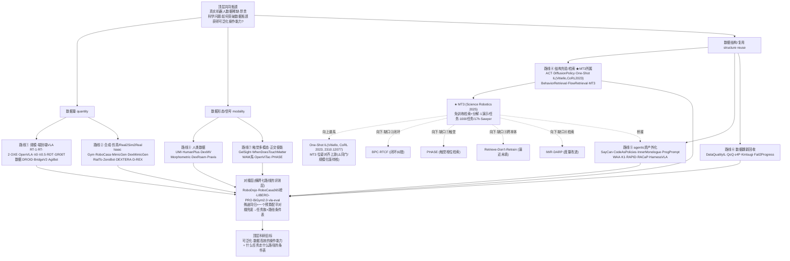

# 领域科研路径图谱 · 具身操作 · v0.1(骨干稿 / draft,未签发)

**性质**:G3 里程碑④ 关联的**综述级文献地图**(黄色产物,草稿制)。
**版本**:v0.1 **骨干稿**(Phase 1);**未走会签前自查复核、未签发、不入 `final/`**。
**起草**:Dexter,2026-10-13(主会话汇总 + 2 路异路径子 agent 补奠基经典与 venue 核实)。
**触发**:委托人 2026-10-13 第五轮指令——现有四透镜分图"调研不够充分、顶刊顶会
核心代表作研究不够、对领域进展了解不全面",要"梳理一个**科学研究发展图谱**,清楚
展现当前领域关注的**科学问题与科研目标**、各路线的**方向/方案方法/进展/新问题**";
以 MT3 为出发点"**向上追溯上层路径、水平查找其他方案、向下调研新进展/新问题**",
梳理完整领域科研路径图谱。AskUserQuestion 三项已答:产出=结构化文档+可视化图谱;
推进=分阶段(先骨干再逐支深挖);语料=**顶会顶刊代表作为骨 + arXiv 最新为肉**。
**与既有产物关系**:本件是四透镜分图 v1(语料边界仅 2026-09 两日窗、止于摘要层)的
**向上补全**(回溯 2021-2026 奠基经典 + venue 核实)+ **重新组织**(按"共同瓶颈→
路线→方法→新问题"的图谱结构,而非按透镜切分)。**不推翻分图,是补其奠基缺口与
venue 维度。**

---

## TL;DR

- **顶层共同瓶颈(所有路线殊途同归指向它)**:真实机器人数据**稀缺且昂贵**(无互联网级
  数据),而操作能力要求**接触富集、跨物体、长程**——**"如何突破数据瓶颈,获得可泛化
  的操作能力?"** 是领域的根本科学问题。
- **七条研究路线**是对"瓶颈在哪、怎么破"的七种押注:**①规模(端到端 VLA+数据集)/
  ②合成(仿真造数据)/ ③人类数据(借人演)/ ④结构先验与检索(分解+检索,MT3 所属)/
  ⑤agentic 资产外化(能力外化成可复用程序/技能)/ ⑥数据翻新回收(坏数据再用)/
  ⑦触觉多模态(更丰富信号,正交使能)**。
- **MT3 的坐标**:属路线④,与 One-Shot IL(Vitiello et al., CoRL 2023, 2310.12077)同属
  one-shot 位姿估计—轨迹迁移脉络,MT3 的位姿对齐步骤引用其作上游(⚠️ 待核:此『规模化+检索版/同门』表述原建立在把 2310.12077 误标为 STRAP 之上,须对 MT3 全文重新核实二者关系);它把
  "免训练检索 + 分解"推到 1,000 任务/单机 17h 的极端;它的四个自陈缺口(无触觉/
  开环单交互/单本体/检索内禀缺陷)分别通向路线⑦②①④的下游新问题。
- **演进主线(2021→2026)**:仿真吞吐基建(Isaac Gym)→ 真机数据规模化(RT-1/OXE/DROID)
  → VLA 范式确立(RT-2)→ 开源复现(OpenVLA/Octo)→ 动作头分岔(π0 flow-matching /
  RDT diffusion / GR00T 双系统)→ 数据引擎多样化(合成/人演/翻新)→ **检索式免训练
  路线(MT3)与 agentic 资产路线(WAA/K1)在 2025-2026 并起** → **评测对撞基建
  (RoboDojo/LIBERO-PRO/BiGym 2.0)成为新焦点**。
- **殊途同归 + 一个对撞层**:七条路线各自推进(能力推进合法),但顶层"什么任务走
  什么路径"的条件表**逻辑上必须有同口径对撞数据**才能拼出(委托人 2026-10-13 裁决:
  保留一个对撞层兜底)。

---

## §0 范围与方法(证据纪律)

- **领域范围**:具身机器人**操作**(manipulation),含数据采集/合成、策略学习范式、
  传感模态、语言长程;不含纯导航/纯感知/纯 RL 理论。
- **时间窗**:**2021-2026**(回溯奠基经典;现有分图仅 2026-09 两日窗,本件补奠基维度)。
- **语料优先级**:**顶会顶刊代表作为骨**(Science Robotics / RSS / CoRL / ICRA / IJRR /
  T-RO / NeurIPS / ICLR / CVPR / ECCV / IROS)+ **arXiv 最新为肉**(2025-2026 前沿)。
- **venue 核实纪律**:每篇的"发表于哪"**必须给核实依据**(arXiv `comment`/`journal_ref`
  逐字,或官方论文集页 roboticsproceedings.org / proceedings.mlr.press / IEEE Xplore /
  Springer / OpenReview / Crossref DOI);**核不到一律标"venue 未核实(仅 arXiv 预印本)",
  绝不编造会议名**。
- **数字纪律**:关键数字带原文位置;摘要无数字者标"⚠️ 摘要零定量";图内/附录数字
  本轮未打开者不报(如 RT-1 流传的"13 万 episode"不在摘要内,未核不报)。
- **本件置信度分层**:奠基经典(venue 已核)= 高;2025-2026 arXiv 前沿(止于摘要)= 中;
  谱系/瓶颈归纳 = 判断(标注)。

---

## §1 顶层:共同瓶颈与科学问题(向上追溯的收敛点)

**这是整张图谱的"根节点"——所有路线向上追溯都收敛到这里。**

### 1.1 根本瓶颈:机器人数据稀缺

与 NLP/CV 不同,机器人操作**没有互联网级数据**:每条真机轨迹都要人 teleoperate 或
演示,昂贵、慢、难规模化。RT-1 用 17 个月采 13 万 episode(注:此数字流传广但**不在
摘要内,本件未核,仅示意量级**);OXE 聚合 22 本体才得 1M+ 轨迹。**数据,是操作学习的
第一性瓶颈。**

### 1.2 顶层科学问题(一句话)

> **如何突破真实机器人数据的稀缺/昂贵瓶颈,获得可泛化(跨物体、跨任务、跨本体、
> 接触富集、长程)的操作能力?**

### 1.3 瓶颈的三个子维度(决定路线分化)

数据瓶颈不是单一的,它有三个子维度,**不同路线押注不同子维度**:
- **数据量**(quantity):要多少条?→ 押注者:路线①规模、②合成。
- **数据形态/信号**(modality):只有视觉够不够?接触信息从哪来?→ 押注者:路线⑦触觉、③人类数据。
- **数据结构/复用**(structure/reuse):能不能不靠"喂更多数据",而靠结构先验、检索、外化资产来省数据?→ 押注者:路线④结构检索、⑤agentic、⑥翻新。

**MT3 押的是第三个子维度(结构/复用)**:用分解+检索,把"每任务所需数据"压到 1 条,
且免训练。**这是它在图谱里的根本坐标。**

---

## §2 MT3 的三向坐标(以它为出发点上/水平/下)

### 2.1 MT3 解决什么问题

**data-efficient imitation learning**:从**每任务 1 条演示**学会**1,000 个日常任务**,
**不训练策略网络**(免训练检索),单台 Sawyer + 单 RealSense D415,17 小时。
方法 = **alignment/interaction 两阶段分解 + 两级检索(语言模板匹配 → PointNet++ 几何
编码 + 余弦 top-1)**;alignment 用解析式位姿估计+运动规划,interaction 用开环速度回放。
(全文核实见 `论文思路-MT3锚定四透镜-v0.2.md` §1;venue = Science Robotics 2025,
DOI 10.1126/scirobotics.adv7594,journal_ref 逐字核实。)

### 2.2 向上追溯(谱系)

```
MT3 (Science Robotics 2025, 2511.10110)
  ← One-Shot Imitation Learning: A Pose Estimation Perspective (Vitiello/Dreczkowski/Johns, CoRL 2023, PMLR 229:943-970, 2310.12077)
      把模仿学习表述为"轨迹迁移 + 未见物体位姿估计"——MT3 的位姿对齐步骤引用其作上游(⚠️ 待核:『规模化+多任务+检索版/同门』表述原建立在把 2310.12077 误标为 STRAP 之上,须对 MT3 全文重核二者关系)
  ← 检索式少样本基座:Behavior Retrieval (RSS 2023, 2304.08742) / FlowRetrieval (CoRL 2024, 2408.16944)
  ← 策略表示基座:ACT/ALOHA (RSS 2023, 2304.13705) / Diffusion Policy (RSS 2023 + IJRR, 2303.04137)
  ← 更上:data-efficient / one-shot imitation learning 这一子领域
  ← 最上:§1 的数据瓶颈(结构/复用子维度)
```

**谱系判断(这是判断)**:MT3 不是凭空出现,它沿 One-Shot IL(Vitiello et al., CoRL 2023)
→MT3 的脉络推进(单演示位姿估计 → 千任务检索库;MT3 位姿对齐步骤引用 2310.12077 作上游),并吸收了检索式少样本
(Behavior/FlowRetrieval)与强策略表示(ACT/DP)的成果。**它的独特性在于"免训练 +
千任务规模",不在方法组件的全新。**(⚠️ 待核:原文称二者为"Imperial 同门"且 MT3 为其"规模化版",此表述原建立在把 2310.12077 误标为 STRAP 之上,须对 MT3 全文重新核实"同门/规模化"关系;故本条置信度由"高"下调。)

### 2.3 水平查找(同一问题的其他解法)

MT3 解决的"data-efficient manipulation",水平上有七条路线(详见 §3)。**与 MT3 同属
路线④(结构先验/检索)的近邻**:One-Shot IL(Vitiello, CoRL 2023,前身/上游)、TP-Flow(1-shot,venue 未核实)、
Res-HIL(20 demos+在线 RL,venue 未核实)、VINN(最近邻检索,ID 未定位)、
FlowRetrieval(光流检索,CoRL 2024)、DARP/IWR(检索度量改进,venue 未核实)。

### 2.4 向下调研(MT3 之后的新进展与新问题)

**新进展(2025-2026,均已开摘要核实;详见新颖性核查 `decisions.md` 2026-10-13 条)**:
- **闭环化**:BPC(2609.30134,训练无关检索式闭环残差纠错,75Hz)、RTCF(2608.04527,
  检索+频域残差纠错)——**直接补 MT3 的"开环"缺口②**。
- **触觉化**:PHASE(2609.30889,Compliance-Enabled Tactile Phase Retrieval)——
  **补 MT3 的"无触觉"缺口①**(但只做插入任务、不做中途闭环纠错)。
- **跨本体**:Retrieve-Don't-Retrain(2606.15631,检索替代逐任务微调,但换本体仍需
  微调)、EmbodiSteer(2606.12965,免训练但对象是已训扩散策略)——**逼近但未填 MT3
  的"单本体"缺口③**(免训练+检索库本身跨本体仍干净开着)。
- **检索度量**:IWR(2509.01657,批最近邻高方差)、DARP(2606.09758,kNN+相对距离)——
  **补 MT3 的"检索内禀缺陷"缺口④的一部分**(但 pose-geometry 解耦、演示间插值仍无人做)。
- **闭环/长程替代基底**:POIL(2609.30404,点云+稳定动力系统,闭环抗扰)、
  ManiLong-Shot(2512.16302,交互事件分解,长程)——在闭环/长程上强于 MT3,但需训模型、规模小。

**新问题(MT3 自陈 + 下游暴露)**:开环无法中途纠错;无触觉→形变物体/高精度插入失败;
单本体;检索不能插值、位姿-几何张力;检索是失败主因(22.3%);跨任务干扰
(seen task performance paradoxically degraded);评测口径不可比(见 §6)。

---

## §3 七条研究路线(水平扩展;殊途同归,各押注瓶颈的一个子维度)

> **⚠️ Phase 2 深挖更新(2026-10-13)**:**路线④与⑤已深挖到子分支 + 全文级 + venue 核实**,
> 见 `reports/drafts/领域科研路径图谱-Phase2-路线④⑤深挖-v0.1.md`。下方 §3.4/§3.5 仍是
> Phase 1 骨干级(每路线 2-4 篇),**以 Phase 2 深挖件为准**。**Phase 2 核出的更正须回流本件**:
> ① **双臂 one-shot = ODIL(2503.06831),ICRA 2025**(§3.4 先前未列;MT3 引为 [48]);
> ② **VINN = 2112.01511(RSS 2022)**、**TP-Flow = 2609.27780**、**PaLM-E = 2303.03378(ICML 2023)**
> (补核准 ID;§3.4/§3.5 与 §8 语料表据此补);③ **Res-HIL(2609.30023)实为人在环残差 RL,
> 非检索/结构先验,路线④归属存疑**——§3.4 若引须移出或标"少样本+在线 RL 混合";
> ④ **venue 新核实**:IWR=CoRL 2025 / ODIL=ICRA 2025 / ManiLong-Shot=AAAI 2026 / DARP=ICLR 2026 /
> ROSER=ICLR 2026 Workshop / PHASE=IROS 2026 / VINN=RSS 2022(§8 语料表 venue 列据此更新);
> ⑤ **口径红线**:K1 的 77.8%/88.9% 是 **18 例匹配子集**(全量 77.2%);PhysEvo 62% 与 RoboDojo
> 官方 8.80% **非同口径(≈7× 分裂),严禁直接对撞/并列**(详见 Phase 2 件 §5)。**其余五路线
> (①②③⑥⑦)深挖排后续轮。**

**每条路线结构**:押注的瓶颈子维度 / 奠基与代表作(**venue 已核实优先**) / 进展 /
遇到的新问题 / 与 MT3 的关系。

### 路线① 规模(端到端 VLA + 数据集基建)

- **押注**:数据**量** + 模型规模——"scale is all you need"。
- **奠基与代表作(venue 已核实)**:
  - **RT-1**(2212.06817,**RSS 2023**):首个可扩展 Robotics Transformer,系统研究泛化
    随数据/模型/多样性的变化(⚠️ 摘要零定量)。
  - **RT-2**(2307.15818,**CoRL 2023**,PMLR 229):确立 **VLA** 范式(动作写成 text token,
    与网络 VQA co-fine-tune);6k evaluation trials。
  - **Open X-Embodiment / RT-X**(2310.08864,**ICRA 2024**,DOI 10.1109/ICRA57147.2024.10611477):
    跨本体标准化数据集,证明正迁移;22 机器人/21 机构/527 skills/160,266 tasks。
  - **OpenVLA**(2406.09246,**CoRL 2024**,PMLR 270):开源 7B VLA,LoRA+量化可消费级
    GPU 微调;970k demos,较 RT-2-X(55B) +16.5%(29 任务,7× 更少参数),较 Diffusion
    Policy +20.4%。
  - **Octo**(2405.12213,**RSS 2024**):开源通用策略,灵活读写头;800k trajectories,9 平台。
  - **π0**(2410.24164,**RSS 2025**,comment 逐字 "Published in RSS 2025"):VLM 上加
    flow-matching 动作头(⚠️ 摘要零定量)。
  - **π0.5**(2504.16054,**CoRL 2025**,PMLR 305):异构共训+混合多模态→开放世界泛化,
    首次端到端系统在全新民居做长时序清洁(⚠️ 摘要零定量)。
  - **RDT-1B**(2410.07864,**ICLR 2025 Poster**,OpenReview 核实):双臂扩散基础模型,
    1.2B 参数,1-5 demos 学新技能。
  - **GR00T N1**(2503.14734,**venue 未核实**,技术报告):双系统 VLA(S2 视觉语言+S1 扩散)。
  - 数据集:**DROID**(2403.12945,**RSS 2024**;76k 轨迹/350h/564 scenes/84 tasks/50 采集者)、
    **BridgeData V2**(2308.12952,**CoRL 2023**;60,096 轨迹/24 环境)、
    **AgiBot World**(2503.06669,**IROS 2025**,DOI 10.1109/IROS60139.2025.11247088;
    >1M 轨迹/217 任务,GO-1 较 OXE +30%)。
- **进展**:VLA 成为主导范式;动作头分岔(flow-matching π0 / diffusion RDT / 双系统 GR00T);
  数据集三代规模台阶(Bridge→DROID/OXE→AgiBot)。
- **新问题**:数据成本极高;语言措辞脆弱(π0.5 "stove" 100% vs "hot plate" 2%,见立场文章支2);
  可解释性差;**规模收益的边际递减与交叉点未测**(MT3 全文自陈"单体 BC 数据够多会反超
  分解法,但交叉点未知")。
- **与 MT3 关系**:**对撞极**——MT3 用 1 demo/task 免训练,正面挑战"scale is all you need";
  MT3 的单体基线 MT-ACT+ 即此路线的小规模代表。

### 路线② 合成(仿真合成 / Real2Sim2Real)

- **押注**:数据**量**——在仿真里廉价制造。
- **奠基与代表作(venue 已核实)**:
  - 仿真基建:**Isaac Gym**(2108.10470,**NeurIPS 2021 D&B**;GPU 并行物理,快 2-3 数量级)、
    **Orbit/Isaac Lab 前身**(2301.04195,**RA-L 2023**,journal_ref 逐字)、
    **RoboCasa**(2406.02523,**RSS 2024**;100 任务/150+ 物体类)、
    **ManiSkill3**(2410.00425,**venue 未核实**;GPU 并行仿真快 10-1000×,30,000+ FPS)。
    **Genesis = 开源软件基建,非论文**(无 arXiv/S2 记录,按"引擎"入列)。
  - 示教放大:**MimicGen**(2310.17596,**CoRL 2023**,comment 逐字;~200 人演→50K+ demos/18 任务)、
    **DexMimicGen**(2410.24185,**ICRA 2025**,comment 逐字;60 源→21K demos,双臂灵巧)。
  - Real2Sim2Real:**RialTo**(2403.03949,**RSS 2024**;少真机数据建 digital twin + inverse
    distillation,鲁棒性 >67%)、**ZeroBot**(2609.34010,**RA-L 2026**,comment 逐字;
    image-to-3D→并行 RL,零示教,真机 87%/训练 119 秒)、**D-REX**(2603.01151,**ICLR 2026 Poster**;
    3DGS 可微 real2sim2real)、**DEXTERA**(2609.21045,**venue 未核实**;单图→灵巧,29.2%→61.9%)。
- **进展**:仿真吞吐基建成熟;示教放大(单臂→双臂灵巧);Real2Sim2Real 四代
  (digital twin RL 微调→单图自动化→生成式零示教→可微物理辨识)。
- **新问题**:sim-real gap(接触物理保真度);合成数据分布覆盖边界;
  **真机 vs 合成 vs 混合配比缺系统消融**(透镜④最大开放问题)。
- **与 MT3 关系**:**互补/对撞**——MT3 不用合成(纯真机检索);混合配比研究(透镜④ 4B)
  可把 MT3 分解作为新自变量(alignment 真机 / interaction 合成)。

### 路线③ 人类数据(免遥操作,借人类演示/视频)

- **押注**:数据**来源**——人演比 teleoperation 便宜。
- **奠基与代表作(venue 已核实)**:
  - **UMI**(2402.10329,**RSS 2024**):手持夹爪接口,野外人演直接迁为可部署策略。
  - **HumanPlus**(2406.10454,**CoRL 2024**):人形影子跟随+自主模仿。
  - **DexMV**(2108.05877,**ECCV 2022**):人手视频→多指灵巧手,仿真+重定向奠基。
  - venue 未核实(2025-2026 前沿):**Morphometric Imitation**(2609.28660;动捕重定向,
    真机 89.3% 零样本;**⚠️ v2 口径:4.5mm/Sharpa 手/8-28 分/bootstrap 保留**)、
    **DexRoam**(2609.35761)、**Praxis**(2609.30735)、**Ego2Robot**(2608.02580)。
  - **ID 不确定(本件不报 venue/数字)**:EgoAct、VINN、TP-Flow(子 agent 未定位准 ID)。
- **进展**:从"重定向动作"升级到"对齐每个模态"(本体/动作语义/时序/视觉/触觉逐项对齐)。
- **新问题**:人-机差距要对齐到什么程度;**视频(非动捕)人演重定向仍开放**;
  规模化人演(Ego2Robot 18,561h)vs per-task 够用(Praxis 1 条)的争点。
- **与 MT3 关系**:**平行**——MT3 用机器人 teleoperation 演示(1 条/任务),不用人演;
  但 MT3 的检索库可由人演数据扩充(开放方向)。

### 路线④ 结构先验 / 检索(MT3 所属)

- **押注**:数据**结构/复用**——用结构先验与检索省数据。
- **奠基与代表作(venue 已核实)**:
  - **ACT/ALOHA**(2304.13705,**RSS 2023**):低成本双臂+Action Chunking Transformer,毫米级精细。
  - **Diffusion Policy**(2303.04137,**RSS 2023 + IJRR 扩展**):扩散策略,12 任务/4 基准较
    SOTA 平均 +46.9%(摘要首段)。
  - **One-Shot IL(Vitiello/Dreczkowski/Johns)**(2310.12077,**CoRL 2023**,PMLR 229:943-970):单演示,模仿学习=轨迹迁移+未见物体位姿估计(MT3 位姿对齐上游)。
  - **Behavior Retrieval**(2304.08742,**RSS 2023**):查询无标注数据集做少样本模仿。
  - **FlowRetrieval**(2408.16944,**CoRL 2024**,PMLR v270):光流引导检索,少样本模仿。
  - **MT3**(2511.10110,**Science Robotics 2025**):见 §2。
  - venue 未核实:TP-Flow(1-shot 66.8%)、Res-HIL(2609.30023)、DARP(2606.09758)、IWR(2509.01657)。
- **进展**:从"学策略"到"检索演示";从单演示位姿估计(One-Shot IL,Vitiello)到千任务检索库(MT3);
  检索度量持续改进(光流/重要性加权/kNN 邻域)。
- **新问题**:检索不能插值;位姿-几何张力;检索是失败主因(22.3%);
  **分解破坏跨任务表示共享**(MT3 自陈 "decomposition prevented this beneficial
  representation sharing")。
- **与 MT3 关系**:**MT3 的本路线**;下游 BPC/RTCF(闭环)、PHASE(触觉)、
  Retrieve-Don't-Retrain(跨本体)都是此路线的延伸。

### 路线⑤ agentic / 资产外化

- **押注**:数据**复用**——把能力外化成可复用程序/技能/工具,几乎不依赖策略训练数据。
- **奠基与代表作(venue 已核实)**:
  - **SayCan**(2204.01691,**CoRL 2022**):可供性打分把 LLM 语义接地到可执行技能。
  - **Code as Policies**(2209.07753,**ICRA 2023**,IEEE Xplore 核实):LLM 直接写机器人策略代码。
  - **Inner Monologue**(2207.05608,**CoRL 2022**):环境反馈以语言回灌 LLM 做闭环规划。
  - **ProgPrompt**(2209.11302,**ICRA 2023**):LLM 生成情境化程序式任务计划。
  - venue 未核实(2025-2026 前沿):**WAA**(2609.29964,LIBERO-Pro 75.6%)、**Robo-Harness K1**
    (2609.29389,77.8%/88.9%)、**RAPID**(2609.30249)、**RACaP**(2609.29394,13.2× 加速)、
    **DexAgent**(2609.35318)、**Recursive Harness Distillation**(2609.33378,playbook 37.3%→64.0%)。
- **进展**:从"LLM 做高层规划"(SayCan/CaP)到"演化可复用资产"(技能库/工具接口/程序/
  playbook);2026 主流形态是**包一个冻结策略**(Harness VLA 2607.08448:把冻结 VLA 当
  可重试接触原语 + LLM 互补语义推理)——**组合赢,不是取代**。
- **新问题**:资产质量没有评测口径(复用率/迁移率);依赖高层 LLM 可靠性;
  失败模式="幻觉出不连贯任务序列"(MT3 Appendix F 自陈);**agentic↔策略在共享榜上
  受控缺席 + 同基准 5-8 倍口径分裂**(见 §6)。
- **与 MT3 关系**:**桥接**——MT3 检索库(534 micro skills)本身是分层路径产物,
  配 LLM 路由就变 agentic 资产(MT3 Appendix F 已用 Grok 3 做 PoC,但无真机严格评测)。

### 路线⑥ 数据翻新 / 回收

- **押注**:数据**复用**——坏数据/失败数据也含信息。
- **奠基与代表作(venue 已核实)**:
  - **Data Quality in Imitation Learning**(2306.02437,**NeurIPS 2023**,Crossref 核实):
    理论奠基,从分布偏移形式化"数据质量",提出 action divergence + transition diversity;
    关键结论"state diversity 并非总有益"(⚠️ 摘要零定量)。
  - **QoQ**(2603.09056,**ICRA 2026**,comment 逐字):数据质量=对降低验证 loss 的贡献,影响函数估计。
  - **Fail2Progress**(**CoRL 2025**,PMLR 305;⚠️ 仅核 venue 未开摘要,不报贡献/数字)。
  - venue 未核实:**ε4P / Imperfection for Precision**(2609.26672;翻新低精度+错配数据,
    **+31.7pp 上限;等量替换降 4.2pp**——⚠️ 引用取"错配翻新上限",不取"等量替换")、
    **Kintsugi-VLA**(2609.31048;失败 rollout→恢复数据,34.6%/38.4%;**⚠️ comment
    "applied on ICRA2027" = 投稿中,不得报为已发表**)。
- **进展**:从"筛数据"(QoQ)到"改数据"(ε4P 重新配位)到"回收失败"(Kintsugi/Fail2Progress)。
- **新问题**:翻新数据的质量度量缺失;**"坏数据含信息"使真机vs合成二分会更复杂**。
- **与 MT3 关系**:**延伸**——MT3 检索库只存成功演示;翻新数据可扩充检索库覆盖
  (透镜④ 4C 路径),攻 MT3 自陈的失败任务族。

### 路线⑦ 触觉 / 多模态(正交使能维度)

- **押注**:数据**形态/信号**——更丰富的接触信号,省数据或赋能接触富集任务。
- **奠基与代表作(venue 已核实)**:
  - **GelSight**(1708.00922,**IROS 2017**):弹性体+反射膜测 3D 几何与接触力,高分辨率触觉奠基。
  - venue 未核实(2025-2026 前沿):**When Does Touch Matter?**(2609.24068,受控对撞方法论
    模板)、**DexTacWAM/VT-WAM/TacWAM**(视触世界模型系)、**OpenViTac**(2610.10384,
    统一 sim-real 视触基准;**⚠️ 高风险锚点:intro 53.3/48.5 与 Table 2/3 的 37.4/29.0
    矛盾,不得作外部引用锚点;披露不足第三方不可复现**)、**PHASE**(2609.30889,触觉相位检索)。
- **进展**:从"触觉当额外输入通道"(naive,可负收益)到"触觉做进世界预测"(WAM 系);
  受控对撞方法论出现(2609.24068 逐模态加减;OpenViTac 任务级开关 +13.6/+13.5pp)。
- **新问题**:触觉在大规模数据占比过低;**视触融合消融证据仍薄**(缺多骨干复现/因子交叉/
  统计严谨/灵巧手/可复现披露);触觉×合成、触觉×agentic 几乎空白。
- **与 MT3 关系**:**正交但互补**——MT3 无触觉(自陈是形变物体失败根因);
  alignment/interaction 分解天然对应"视觉主导/接触主导",给"触觉在哪个阶段有价值"
  提供干净脚手架(透镜② 路径 2A/2B)。

---

## §4 演进时间线(2021-2026)

| 年 | 里程碑(venue 已核实优先) | 意义 |
|---|---|---|
| 2021 | Isaac Gym(NeurIPS 2021 D&B);GelSight 系(IROS 2017 起) | 仿真吞吐基建 + 触觉传感奠基 |
| 2022 | SayCan(CoRL 2022)、Inner Monologue(CoRL 2022)、DexMV(ECCV 2022)、RT-1(RSS 2023 提交于 2022) | agentic 高层规划起点 + 真机数据规模化起点 + 人演重定向起点 |
| 2023 | RT-2(CoRL 2023)确立 VLA;ACT/ALOHA、Diffusion Policy(RSS 2023);Code as Policies、ProgPrompt(ICRA 2023);MimicGen、One-Shot IL(Vitiello)、Behavior Retrieval、BridgeData V2(CoRL 2023);Data Quality in IL(NeurIPS 2023) | **VLA 范式确立 + 结构先验/检索路线成形 + 数据质量理论奠基** |
| 2024 | OXE/RT-X(ICRA 2024)、OpenVLA(CoRL 2024)、Octo、DROID、UMI、RialTo(RSS 2024)、HumanPlus、FlowRetrieval(CoRL 2024)、RoboCasa(RSS 2024) | 开源复现 + 数据集基建 + 人类数据接口 + 检索式少样本成熟 |
| 2025 | π0(RSS 2025)、π0.5(CoRL 2025)、RDT-1B(ICLR 2025)、AgiBot World(IROS 2025)、DexMimicGen(ICRA 2025)、**MT3(Science Robotics 2025)**、Fail2Progress(CoRL 2025) | 动作头分岔 + 数据规模新台阶 + **免训练检索路线登顶(千任务)** |
| 2026 | 闭环检索(BPC/RTCF)、触觉检索(PHASE)、跨本体检索(Retrieve-Don't-Retrain)、agentic 资产(WAA/K1/RAPID/RACaP)、翻新(ε4P/Kintsugi)、ZeroBot(RA-L 2026)、QoQ(ICRA 2026)、D-REX(ICLR 2026);**评测对撞基建**(RoboDojo/RoboCasa365 榜/LIBERO-PRO/LIBERO-Plus/BiGym 2.0/vla-eval) | **MT3 缺口被下游逐一攻 + agentic 与检索并起 + 评测对撞成为新焦点** |

**演进判断(这是判断,置信度中-高)**:领域重心正从"**造更强的模型/采更多的数据**"
转向"**①更省数据的结构(检索/分解)②可复用的资产(agentic)③更诚实的评测(对撞基建)**"。
MT3(免训练检索,Science Robotics 2025)与评测对撞基建(2025-2026 井喷)是这一转向的
两个标志。

---

## §5 殊途同归:七路线如何服务同一瓶颈 + 对撞层的位置

**殊途同归(委托人框架,已采纳)**:七条路线都服务 §1.2 的顶层科学问题(突破数据瓶颈、
获得可泛化操作能力),只是押注瓶颈的不同子维度(量/形态/结构复用)。**各路线可独立
推进,不必彼此对撞**——端到端把规模上限推高、结构检索把数据效率推高、agentic 把复用
推高、触觉把信号维度补全,**合起来才是完整的能力版图**。

**但必须保留一个对撞层(委托人 2026-10-13 裁决)**:顶层目标"什么任务走什么路径"的
**条件表**,每格都是比较级命题,**逻辑上必须由同口径成对观测赋值**。因此:
- **能力推进型论文**(各路线攻自己的缺口)= 主体,殊途同归,不必对撞;
- **一个预算配平对撞层**(agentic↔策略,复制 BiGym 2.0 做法)= 兜底,让条件表可判定。
- **不对撞的代价已被实证**:LIBERO-PRO(90%→0.0%)、LIBERO-Plus(95%→<30%)、
  PhysEvo 自称 62% vs RoboDojo 官方 8.80%(≈7 倍口径分裂)——**不对撞不仅拼不出真表,
  还生产假表**。

**对撞层在图谱里的位置**:它不是第八条路线,而是**横跨七路线的评测层**(§6 的评测口径
问题 + BiGym 2.0/RoboDojo/vla-eval 基建)。

---

## §6 分歧与开放问题

- **分歧一:规模 vs 结构 vs 外化**——路线①(scale)vs ④(结构检索)vs ⑤(agentic)。
  **现状**:端到端↔分层**已在共享榜硬对撞**(RoboDojo 30 策略同表 / RoboCasa365 18 模型);
  **真正缺席的是 agentic↔策略**(两榜全文 grep agentic/agent/harness=0)+ 同基准 5-8 倍
  口径分裂。**未定案;对撞缺席本身是发现(须分层重写,见 review-ledger 待重审)。**
- **分歧二:真机 vs 合成 vs 翻新**——路线②③ vs ⑥。焦点已从"能不能生成"移向
  "分布覆盖与配比";**混合配比系统消融缺失**。未定案。
- **分歧三:触觉的边际价值**——路线⑦。真问题是"怎么用/何时用"而非"有没有用";
  受控对撞已有单点(2609.24068)与万级新证(OpenViTac),但**规模化受控对撞仍缺**。未定案。
- **开放问题(图谱级)**:
  1. **评测口径不统一 + 对撞缺席**——领域最大方法论缺口(数字失去指称)。
  2. **数据成本-成功率可比表缺失**——各路线曲线不可比(透镜① 最大开放问题)。
  3. **agentic 资产质量无度量**——复用率/迁移率无口径(透镜③ 开放问题⑤)。
  4. **跨本体免训练迁移仍开着**——MT3 缺口③,Retrieve-Don't-Retrain 逼近但未填。
  5. **触觉×合成、触觉×agentic 双重空白**。
  6. **scaling 交叉点未测**——分解法 vs 单体 BC 何时反超(MT3 自陈未知)。

---

## §7 可视化图谱(mermaid)

> 独立可渲染文件见 `reports/drafts/领域科研路径图谱-v0.1.mermaid`。下方为同一图的源码。



---

## §8 语料清单 / 回指表(venue 已核实优先)

**venue 已核实(顶会顶刊骨干,30 篇)**:

| 路线 | 论文 | arXiv | venue(依据) |
|---|---|---|---|
| ① | RT-1 | 2212.06817 | RSS 2023(roboticsproceedings rss19/p025) |
| ① | RT-2 | 2307.15818 | CoRL 2023(PMLR 229) |
| ① | OXE/RT-X | 2310.08864 | ICRA 2024(Crossref DOI) |
| ① | OpenVLA | 2406.09246 | CoRL 2024(PMLR 270) |
| ① | Octo | 2405.12213 | RSS 2024(rss20/p090) |
| ① | π0 | 2410.24164 | RSS 2025(comment 逐字) |
| ① | π0.5 | 2504.16054 | CoRL 2025(PMLR 305) |
| ① | RDT-1B | 2410.07864 | ICLR 2025 Poster(OpenReview) |
| ① | DROID | 2403.12945 | RSS 2024(rss20/p120) |
| ① | BridgeData V2 | 2308.12952 | CoRL 2023(PMLR 229) |
| ① | AgiBot World | 2503.06669 | IROS 2025(IEEE DOI) |
| ② | Isaac Gym | 2108.10470 | NeurIPS 2021 D&B(S2+DBLP) |
| ② | Orbit/Isaac Lab 前身 | 2301.04195 | RA-L 2023(journal_ref) |
| ② | RoboCasa | 2406.02523 | RSS 2024(comment 逐字) |
| ② | MimicGen | 2310.17596 | CoRL 2023(comment 逐字) |
| ② | DexMimicGen | 2410.24185 | ICRA 2025(comment 逐字) |
| ② | RialTo | 2403.03949 | RSS 2024(rss20/p015) |
| ② | ZeroBot | 2609.34010 | RA-L 2026(comment 逐字) |
| ② | D-REX | 2603.01151 | ICLR 2026 Poster(comment 逐字) |
| ③ | UMI | 2402.10329 | RSS 2024(rss20/p045) |
| ③ | HumanPlus | 2406.10454 | CoRL 2024(GitHub+OpenReview) |
| ③ | DexMV | 2108.05877 | ECCV 2022(Springer) |
| ④ | ACT/ALOHA | 2304.13705 | RSS 2023(roboticsconference) |
| ④ | Diffusion Policy | 2303.04137 | RSS 2023 + IJRR(comment 逐字) |
| ④ | One-Shot IL(Vitiello/Dreczkowski/Johns) | 2310.12077 | CoRL 2023(PMLR 229:943-970) |
| ④ | Behavior Retrieval | 2304.08742 | RSS 2023(rss19/p011) |
| ④ | FlowRetrieval | 2408.16944 | CoRL 2024(PMLR v270) |
| ④ | MT3 | 2511.10110 | Science Robotics 2025(journal_ref+DOI) |
| ⑤ | SayCan | 2204.01691 | CoRL 2022(aiconfpaper) |
| ⑤ | Code as Policies | 2209.07753 | ICRA 2023(IEEE Xplore) |
| ⑤ | Inner Monologue | 2207.05608 | CoRL 2022(官方站) |
| ⑤ | ProgPrompt | 2209.11302 | ICRA 2023(NVIDIA LPR) |
| ⑥ | Data Quality in IL | 2306.02437 | NeurIPS 2023(Crossref) |
| ⑥ | QoQ | 2603.09056 | ICRA 2026(comment 逐字) |
| ⑥ | Fail2Progress | (PMLR 305) | CoRL 2025(PMLR;⚠️ 仅核 venue 未开摘要) |
| ⑦ | GelSight | 1708.00922 | IROS 2017(comment) |

**venue 未核实(2025-2026 arXiv 前沿,止于摘要,作"肉")**:GR00T N1(2503.14734)、
ManiSkill3(2410.00425)、DEXTERA(2609.21045)、Morphometric(2609.28660)、DexRoam(2609.35761)、
Praxis(2609.30735)、Ego2Robot(2608.02580)、Res-HIL(2609.30023)、DARP(2606.09758)、
IWR(2509.01657)、ε4P(2609.26672)、Kintsugi-VLA(2609.31048,⚠️"applied on ICRA2027"=投稿中)、
WAA(2609.29964)、K1(2609.29389)、RAPID(2609.30249)、RACaP(2609.29394)、DexAgent(2609.35318)、
Recursive Harness Distillation(2609.33378)、Harness VLA(2607.08448)、When Does Touch Matter(2609.24068)、
DexTacWAM(2609.24976)、OpenViTac(2610.10384,⚠️ 高风险锚点)、PHASE(2609.30889)、
BPC(2609.30134)、RTCF(2608.04527)、Retrieve-Don't-Retrain(2606.15631)、EmbodiSteer(2606.12965)、
POIL(2609.30404)、ManiLong-Shot(2512.16302)、RoboDojo(2607.04434)、BiGym 2.0(2610.07594)、
LIBERO-PRO(2510.03827)、LIBERO-Plus(2510.13626)、vla-eval(2603.13966)。
**非论文软件基建**:Genesis(开源引擎,无 arXiv/S2 记录)。
**ID 不确定(本件不报)**:EgoAct、VINN、TP-Flow(子 agent 未定位准 ID,Phase 2 须补核)。

**回指**:本件路线/分歧/开放问题承接四透镜分图 v1(①②③④)与综述 v1.0.2(12 格矩阵);
MT3 全文细节回指 `论文思路-MT3锚定四透镜-v0.2.md` §1;新颖性核查回指 `decisions.md`
2026-10-13 条 + `honor.md` 2026-10-13 条;对撞证据回指 review-ledger 证据触发待重审新行。

---

## §9 置信度自评与残余不确定性

- **置信度高**:奠基经典的 venue(30 篇,依据 arXiv comment/journal_ref 逐字或官方
  论文集页/DOI/OpenReview);MT3 全文细节(三级核实);七路线的押注定位。
- **置信度中**:2025-2026 arXiv 前沿(止于摘要,未读全文,venue 未核实);
  演进时间线的"重心转向"判断;谱系归纳。
- **残余不确定性(诚实条款)**:
  1. **本件是骨干稿(Phase 1)**——每条路线只锚定 2-4 篇代表作,**未穷尽**;
     Phase 2 须逐支深挖(每路线扩到 8-15 篇 + 读全文 + 补 2026 最新)。
  2. **未走会签前自查复核**——按 deep-read §4,签发前须派独立子任务复核(逐条比对
     数字 + 专查四类错误 + 实抓入口 URL)+ 外部交叉源;**本件 v0.1 未做,故不签发**。
  3. **venue 核实有盲区**——部分靠二手来源(GitHub 标注/aiconfpaper/S2+DBLP),
     未逐一核官方论文集页原文;ICRA/IROS/CoRL 2026 录用名单可能未全公开。
  4. **ID 不确定项**(EgoAct/VINN/TP-Flow)未定位准,Phase 2 须补核。
  5. **数字多在摘要层**——⚠️ 标注的"摘要零定量"篇目(RT-1/π0/π0.5/GR00T/Data Quality IL)
     的关键数字须读全文/正文表格补核,本件不凭记忆补。
  6. **权威性检验(≥3 处跨源口径定案)未做**——deep-read §3 要求,本件 v0.1 未做,
     Phase 2 或签发前须补(候选:DROID 84/86、OXE 21/34、LIBERO-Pro 总任务数、
     OpenViTac 53.3/48.5 vs Table 2/3 矛盾)。

---

## ✏️ 2026-10-15 权威性检验回流更正(STRAP 张冠李戴)

- **错在哪**:本件多处把 arXiv:2310.12077 标注为「STRAP(CoRL 2023)」,并据此构建
  「MT3 = STRAP 的规模化+检索版 / 同门前身」的谱系叙事。经核,**2310.12077 不是 STRAP**——
  张冠李戴(名字错,ID / venue / 所述内容均属实)。
- **核实依据(主会话 2026-10-15 独立 curl arXiv)**:
  - **2310.12077** =《One-Shot Imitation Learning: A Pose Estimation Perspective》,作者
    **Vitiello, Pietro / Dreczkowski, Kamil / Johns, Edward**,2023-10-18,**CoRL 2023,
    PMLR 229:943-970**。所述内容(one-shot IL、位姿估计视角、Sawyer、~1500 rollouts、
    平均超 DOME ~22%)都属实,**只有「STRAP」这个名字是错的**。
  - **2412.15182** =《STRAP: Robot Sub-Trajectory Retrieval for Augmented Policy Learning》,
    作者 **Memmel / Berg / Chen / Gupta / Francis**,2024-12-19,**venue = ICLR 2025 Poster**
    (OpenReview 4VHiptx7xe)——**这才是真正的 STRAP**。(注:「STRAP 为 RSS 2024」一说无出处,不予断言。)
- **本件处理方式**:凡「STRAP」指向 2310.12077 处,一律改名为「One-Shot IL(Vitiello et al.,
  CoRL 2023)」或其全称,ID / venue / 内容保留不变(**约 10 处**:§TL;DR MT3 坐标条、§2.2 谱系
  代码块与谱系判断段、§2.3 近邻条、§3.4 代表作与进展条、§4 时间线 2023 行、§7 mermaid 两处
  节点、§8 语料表④行)。本件未出现指向真 STRAP(2412.15182)的条目。
- **谱系表述降级为待核**:原「MT3 = STRAP 的规模化+检索版 / 同门」叙事建立在误标之上。
  **已核实、可保留的**是:MT3(2511.10110)的位姿估计对齐步骤引用 Vitiello et al.(2310.12077)
  作上游。**未核实、已就地标 ⚠️ 待核的是**:「规模化+检索版 / 同门(Imperial)」这一更强表述——
  须对 MT3 全文重新核实二者关系,不得再作为既定事实断言;§2.2「谱系判断」置信度已由「高」下调。

---

## 署名链

- **起草**:Dexter(2026-10-13,主会话汇总 + 2 路异路径子 agent 补奠基经典与 venue 核实)。
- **性质**:综述级文献地图(黄色产物),**领域科研路径图谱 Phase 1 骨干稿**。
- **状态**:**v0.1 草稿,未走会签前自查复核、未签发、不入 `final/`、不署名/不投稿/不发布/不对外**。
- **下一步**:① Phase 2 逐支深挖(每路线扩 8-15 篇 + 读全文 + 补 2026 最新 + 补核
  ID 不确定项);② 权威性检验(≥3 处跨源口径定案);③ 会签前自查复核(独立子任务 +
  外部交叉源)→ 签发 v1.0 入 `final/` + 登记 review-ledger。
- **复核**:______(待 Phase 2 后走 §4 会签前自查复核)
- **签发**:______(未签发)
