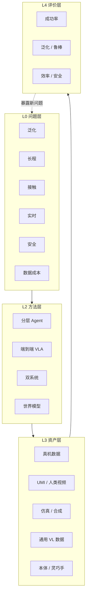

# 具身智能机器人研究地图：路线、演化与 2026 前沿

**版本**：v1.0（自审签发）
**日期**：2026-10-19
**范围**：以机器人操作（manipulation）为主线，兼顾导航、人形机器人与灵巧手；时间截至 2026 年 10 月。
**方法**：检索 arXiv / OpenAlex / 官方博客；精读或重点阅读 10 篇综述，摘要级阅读 4 篇；逐条核验 13 个里程碑论文的 arXiv ID 与日期。

---

## 摘要

具身智能机器人研究正在经历第二次范式转移：从“为每个任务训练一个策略”，转向“用基础模型 + 跨本体数据 + 统一评测”构建通用机器人系统。第一次转移发生在 2012—2022 年，主题是“用学习替代手工建模”；第二次发生在 2022 年之后，主题是“用基础模型替代单任务策略”。第二次转移带来了能力叙事的快速膨胀，也暴露了一个更根本的瓶颈：**领域缺少能判定“某种路线是否真的更好”的测量体系**。

本文以 14 篇综述为骨架，给出五层研究地图（问题—能力—方法—资产—评价）、六条技术路线、三段历史与六个 AI 子阶段，并梳理 2025—2026 年的八个关键进展与十个可判定问题。核心判断有三条：

1. **VLA 不是终点，而是“感知—语言—动作”接口的标准化过程。** 真正决定系统上限的，是接口之下有没有可执行的物理世界模型，以及接口之上有没有可验证的数据闭环。
2. **端到端与分层之争已经收敛为“双系统”工程折中，但理论分歧并未解决。** 争论的实质不再是“要不要分层”，而是“把接口放在哪里、由谁承担错误恢复”。
3. **2026 年最稀缺的不是新模型，而是对照实验。** 世界模型是否带来闭环增益、触觉的边际价值有多大、数据配方是否存在 scaling law——这些问题目前都缺少同预算、同任务的对照测量。

---

## 0. 一页纸地图

| 层 | 内容 | 回答的问题 |
|---|---|---|
| **L4 评价层** | 成功率 / 泛化 / 鲁棒 / 效率 / 安全 | 怎么证明它更好？ |
| **L3 资产层** | 数据（真机 / UMI / 自我中心视频 / 仿真 / 通用 VL）· 本体（臂 / 人形 / 灵巧手）· 仿真器 · 基准 | 用什么训练、用什么身体？ |
| **L2 方法层** | 决策架构（分层 / 端到端 / 双系统 / 世界模型）× 学习范式（IL / RL / 自监督）× 动作生成（AR / Diffusion / Flow） | 怎么学？ |
| **L1 能力层** | 感知与 3D 理解 · 语言条件操作 · 长程规划 · 接触-rich 灵巧操作 · 移动 / 全身控制 | 能做什么？ |
| **L0 问题层** | 泛化（对象 / 场景 / 任务 / 本体）· 长程误差累积 · 接触物理 · 实时性 · 安全 · 数据成本 | 为什么难？ |

读图方式：**从下往上**是“问题驱动方法、方法依赖资产、资产决定可测能力”；**从上往下**是“评价暴露问题、问题倒逼新方法”。六条路线（§4）是 L2 上的不同切法，不是互斥的阵营。可视化版本见 §10 的 Mermaid 图。

---

## 1. 领域边界：什么算具身智能

### 1.1 三种定义，三种用法

| 定义 | 核心 | 代表表述 | 适用场景 |
|---|---|---|---|
| 弱定义 | 有身体的 AI | “智能不能只存在于抽象问题求解中，还要能应对物理世界的复杂与不可预测” | 科普、跨领域对话 |
| 强定义 | 通过身体与环境的交互产生智能 | “智能可以从智能体与环境的交互中涌现” | 认知科学、AGI 论证 |
| 工程定义 | 感知—决策—行动闭环，在真实或仿真环境中完成语言条件任务 | 以 VLA / 机器人学习系统为对象 | 本报告采用 |

三者的差别不在措辞，而在**成功判据**：弱定义只需要“有本体”，强定义要求“智能因身体而不同”，工程定义要求“任务成功率可测”。混用三者，是许多争论各说各话的根源。

**术语陷阱**：英文 “Embodied AI” 在 2019—2022 年常指虚拟环境中的导航、EQA 与交互（Habitat、AI2-THOR 一系），物理机器人操作更多归入 “robot learning”；2023 年后两者才明显合流。读旧综述时先看它的范围声明——例如 [2103.04918](https://arxiv.org/abs/2103.04918) 明确写明不覆盖 sim2real 与物理机器人。

### 1.2 与相邻概念的分界

- **互联网 AI vs 具身 AI**：前者从静态数据集中学习，认知与物理实体脱钩；后者把认知嵌入物理实体，强调主动感知与动作后果（[2407.06886](https://arxiv.org/abs/2407.06886) 表 I）。
- **传统机器人 vs 学习式机器人**：传统路线依赖建模、规划与控制，优势是可解释、可保证；学习路线依赖数据与泛化，优势是开放环境适应。2020 年后的主流是两者混合，而非替代。
- **具身智能 vs 具身认知**：后者是认知科学命题（身体塑造认知），前者是工程命题（如何构建系统）。工程上可以借用前者的直觉，但不能把哲学主张当作技术判据。

### 1.3 问题空间：六个硬约束

| 约束 | 具体表现 | 为什么难 |
|---|---|---|
| 泛化 | 新物体、新场景、新任务、新本体 | 机器人数据分布窄，语言/视觉先验强但物理 grounding 弱 |
| 长程 | 多步骤任务、错误累积、信用分配 | 单步误差在闭环中放大；奖励稀疏 |
| 接触 | 抓取、装配、可变形物、in-hand 操作 | 接触物理难建模、难仿真、难感知 |
| 实时 | 控制频率、端侧算力、网络依赖 | 大模型推理延迟与闭环稳定性冲突 |
| 安全 | 人身安全、对抗攻击、故障传播 | 数字错误会变成物理伤害 |
| 数据 | 采集成本、跨本体对齐、许可 | 真机数据贵，仿真有 gap，视频缺动作标签 |

### 1.4 四个研究目标

[2407.06886](https://arxiv.org/abs/2407.06886) 把领域拆成四个目标，至今仍是最好用的“总图”之一：

1. **具身感知**：主动视觉、vSLAM、3D 场景理解、视觉语言导航；
2. **具身交互**：具身问答、语言引导抓取、端到端/模块化操作；
3. **具身智能体**：高层任务规划 + 低层动作规划，LLM/VLM/VLA 三类大脑；
4. **Sim-to-Real**：世界模型、数据采集与训练、五种迁移范式（Real2Sim2Real、TRANSIC、域随机化、系统辨识、Lang4Sim2Real）。

这个四分法的价值在于：它把“模型”放回系统里，避免了“只比较 VLA 参数量”的窄视。

---

## 2. 发展过程：三段大历史，六个 AI 子阶段

### 2.1 三段大历史

[2507.11840](https://arxiv.org/abs/2507.11840) 对机器人操作给出了一个清晰的三段划分，本文沿用：

| 阶段 | 时间 | 核心 | 代表 | 瓶颈 |
|---|---|---|---|---|
| 机械编程 | 1960s—1990s | 预编程、示教再现、结构化产线 | Unimate、PUMA560 | 无外部感知，无法适应变化 |
| 闭环控制 | 1990s—2010s | 视觉伺服、力控、模型基规划 | ABB YuMi、视觉伺服装配 | 依赖精确建模，非结构化环境失效 |
| 具身智能操作 | 2010s—至今 | 多模态感知、端到端学习、语言条件 | RT 系列、OpenVLA、π 系列、GR00T | 泛化、长程、接触、数据、安全 |

前两段的历史教训常被低估：**“感知—控制”闭环的稳定性问题，不会因为换成大模型就消失**。今天 VLA 的延迟、抖动、接触失败，很多是经典控制问题的变体。

### 2.2 六个 AI 子阶段

| 子阶段 | 时间 | 主题 | 关键节点（已核验） | 代表综述 |
|---|---|---|---|---|
| 深度 RL 与 Sim2Real | 2013—2017 | 用试错替代建模 | DQN（2013/2015）、域随机化（2017） | — |
| 基础模型前夜 | 2018—2021 | 表征学习、语言条件、仿真器 | CLIP（2021-02）、ALFRED（2020）、Habitat/iGibson | [2103.04918](https://arxiv.org/abs/2103.04918) |
| VLA 元年 | 2022 | 语言→动作的统一接口 | SayCan（2022-04）、RT-1（2022-12） | — |
| 多模态与跨本体 | 2023 | 网页知识迁移、跨机器人数据 | PaLM-E（2023-03）、Diffusion Policy（2023-03）、RT-2（2023-07）、OXE（2023-10） | [2312.07843](https://arxiv.org/abs/2312.07843)、[2405.14093](https://arxiv.org/abs/2405.14093) |
| 开源与生成式动作 | 2024 | 开源 VLA、流匹配、跨本体策略 | OpenVLA（2024-06）、π0（2024-10）、Octo | [2407.06886](https://arxiv.org/abs/2407.06886)、[2509.19012](https://arxiv.org/abs/2509.19012) |
| 双系统、世界模型、人形 | 2025—2026 | 系统化、数据配方、端侧、安全 | GR00T N1（2025-03）、Gemini Robotics（2025-03）、π0.5（2025-04）、V-JEPA 2（2025-06）、GR00T N1.5（2025-06）、Gemini Robotics 1.5（2025-09）、π*0.6（2025-11）、GR00T N1.6（2026-01）、Gemini Robotics 2（2026-07） | [2512.11362](https://arxiv.org/abs/2512.11362)、[2607.24744](https://arxiv.org/abs/2607.24744) |

### 2.3 一条暗线：接口的标准化

把六年进展串起来，真正在变的是“人怎么把意图交给机器”的接口：

```
语言指令 → 任务分解 → 动作 token → 动作 chunk → 连续动作（diffusion/flow）→ 世界模型中的想象轨迹
```

每往右一步，接口的“带宽”更高、对物理的假设更强，但可解释性和数据效率更低。VLA 的历史，本质上是**在“语义泛化”与“物理精度”之间反复选择接口位置**的历史。2025—2026 的双系统架构，则是承认“一个接口不够”，把慢推理与快控制拆成两个时间尺度。

另一个可观察的演化是**综述体裁**：2021 年的综述按方法/任务组织，2024 年按系统部件组织，2024—2026 年则把数据/资源放到顶层（[2607.24744](https://arxiv.org/abs/2607.24744) 的五层数据金字塔、[2604.23001](https://arxiv.org/abs/2604.23001) 的数据集/基准/数据引擎三分）。领域对自己的描述从“有什么算法”移到“有什么数据”——这本身就是“瓶颈从模型转向资产”的信号。

---

## 3. 五层研究地图

### L0 问题层

见 §1.3。补充一点：这六个约束不是并列的，而是**相互转化**的。数据不足会伪装成泛化问题，泛化不足会伪装成长程问题，长程失败又会伪装成接触问题。诊断时先问“失败发生在哪一层”，比换模型更有效。

### L1 能力层

| 能力 | 最低可测任务 | 当前水平（判断） | 主要障碍 |
|---|---|---|---|
| 开放词汇抓取 | 未见物体抓取 | 较高，工业可用 | 透明/反光/可变形物体 |
| 语言条件桌面操作 | 指令跟随 + 抓放 | 中高，短程可用 | 长指令、指代消解 |
| 长程多步骤任务 | 厨房/整理类 | 中低 | 错误恢复、状态跟踪 |
| 接触-rich 灵巧操作 | in-hand 旋转、装配 | 低—中 | 触觉、数据、控制 |
| 移动操作 / 全身 | 取物、开门、递物 | 中，演示级 | 平衡、安全、成本 |
| 跨本体零样本 | 新机器人少样本适配 | 低—中 | 动作空间对齐 |

“当前水平”是**判断**，依据是综述中的代表性结果与 2025—2026 的厂商演示；没有统一的第三方复现，故不给单一分数。

### L2 方法层

#### 3.1 决策架构：四种切法

| 架构 | 核心主张 | 代表 | 优势 | 硬伤 |
|---|---|---|---|---|
| 分层式 | LLM/VLM 做高层规划，技能库/控制器做低层执行 | SayCan、Inner Monologue、Code as Policies、Hi Robot | 可解释、可插拔、数据效率高 | 接口错配、延迟、规划器与执行器互相甩锅 |
| 端到端 VLA | 一个模型从视觉+语言直接输出动作 | RT-2、OpenVLA、π0、GR00T | 语义泛化强、可 scaling | 数据饥渴、长程弱、缺显式物理 |
| 双系统 | 慢思考（VLM/规划）+ 快反射（扩散/流策略） | GR00T N1/N1.6、Helix、π0.5、Gemini Robotics 1.5/2 | 兼顾推理与实时 | 系统复杂、训练不稳定、接口仍是手工设计 |
| 世界模型驱动 | 先预测未来状态，再规划/选择动作 | Dreamer、V-JEPA 2、Genie 3、Cosmos、WorldVLA、LUMOS | 样本效率、反事实推理 | 误差累积、评测缺对照、sim2real |

#### 3.2 学习范式

- **模仿学习（BC）**：当前 VLA 的主流训练方式。优点是稳定、可扩展；缺点是只能学“演示分布内”的行为，错误会累积。
- **强化学习（RL）**：从结果中学习，能超越演示。2025 年的关键进展是把 RL 稳定地接到大 VLA 上（π*0.6 的 RECAP）；难点是信用分配与真实世界样本成本。
- **自监督/预测式学习**：用视频、未来表征、世界模型做预训练。V-JEPA 2 是代表；优点是可用无动作标签的视频，缺点是下游控制的对齐仍弱。
- **混合式**：BC 预训练 + RL 微调 + 纠正式数据，是 2025—2026 的实际工程配方。

#### 3.3 动作生成

| 方式 | 代表 | 优点 | 缺点 |
|---|---|---|---|
| 自回归 token | RT-2、OpenVLA | 复用 LLM 栈、易统一多模态 | 离散化损失、推理慢 |
| Diffusion | Diffusion Policy、RDT-1B | 多模态分布、平滑轨迹 | 迭代采样、延迟 |
| Flow matching | π0、π0.5 | 少步生成、精度高 | 训练细节敏感 |
| 混合/chunk | π0.5、OpenVLA-OFT | 兼顾语义与频率 | 系统复杂 |

[2512.11362](https://arxiv.org/abs/2512.11362) 的判断值得引用：感知正从通用视觉 backbone 转向“语言对齐（SigLIP）+ 几何（DINOv2）”的混合；大脑正收敛到预训练 VLM；动作正从离散 token 转向连续生成。这三句话可以作为 2026 年架构选择的基本盘。

### L3 资产层

#### 3.4 数据金字塔

[2607.24744](https://arxiv.org/abs/2607.24744) 把具身数据组织为五层金字塔，按“可扩展性”与“机器人对齐度”两个轴排序：

| 层级 | 来源 | 可扩展性 | 机器人对齐 | 主要价值 | 主要代价 |
|---|---|---|---|---|---|
| 顶端 | 真机数据 | 低 | 最高 | 可直接执行的动作监督 | 硬件、人力、复位 |
| 第二层 | UMI 式手持采集 | 中 | 高（末端） | 无机器人也能采动作 | 重定向误差 |
| 第三层 | 自我中心/第三人称人类视频 | 高 | 中 | 真实物理、日常多样性 | 无动作标签、人-机形态差 |
| 第四层 | 仿真数据 | 很高 | 中 | 可执行动作、特权标签 | 接触/摩擦/延迟的 sim2real gap |
| 底层 | 通用视觉语言数据 | 极高 | 低 | 语义与推理覆盖 | 无物理 grounding |

另一篇 2026-04 的数据基础设施综述把 VLA 资源分为**数据集、基准、数据引擎**三支柱，并给出一句值得记住的判断：“The primary limitation of current data engines is **not generation capacity but grounding reliability**.”（[2604.23001](https://arxiv.org/abs/2604.23001) §6.3）——**生成能力在扩，接地能力没扩**。

这张表最重要的含义不是“哪层最好”，而是**没有单一来源能同时满足规模与对齐**。因此 2026 年的竞争点从“谁的数据多”转向“谁的配方好”：如何选、如何对齐、如何混。跨本体对齐有两条技术线——动作空间对齐（维度、控制接口、语义）与几何对齐（视角、坐标系、本体）——目前都缺少标准度量。

#### 3.5 本体与灵巧手

- **臂/夹爪**：最成熟，数据最多，工业落地最快；但只能覆盖“抓放”类任务。
- **人形**：2025—2026 的热点，优势是“为人类环境而生”，劣势是成本、安全、平衡与全身控制的复杂度。
- **灵巧手**：多指、高 DoF、多接触点，能覆盖 in-hand、工具使用、可变形物；但硬件贵、耐用性差、数据少，且存在**人-机形态差**（人手与机械手的尺寸、自由度、驱动方式不同），人类演示不能直接重定向（[2507.11840](https://arxiv.org/abs/2507.11840)）。
- **触觉**：视觉被遮挡时的关键补充；但高分辨率视触觉的成本、标定与仿真保真度仍是瓶颈。2026 年的触觉综述把方法分为多模态感知、跨模态生成、多模态交互三支（[2605.17336](https://arxiv.org/abs/2605.17336)）。

#### 3.6 仿真器与基准

| 类型 | 代表 | 适合 | 不适合 |
|---|---|---|---|
| 物理仿真 | MuJoCo、Isaac Sim/Gym、PyBullet、Genesis | RL、接触、并行采样 | 真实感知细节 |
| 真实场景仿真 | Habitat、AI2-THOR、iGibson、SAPIEN | 导航、EQA、室内交互 | 高精度接触操作 |
| 操作基准 | LIBERO、RLBench、Meta-World、CALVIN、RoboCasa、RoboTwin | 语言条件操作、长程、双臂 | 真实世界泛化 |
| 真实数据资源 | ALOHA、DROID、OXE、AgiBot World | 真机策略学习、跨本体 | 可复现性（硬件依赖） |

基准的碎片化是领域的老问题：同一个“LIBERO 成功率”在不同论文里可能对应不同的任务子集、不同的评测协议、不同的训练预算。读到任何 SOTA 数字，先问三件事：**任务集、评测协议、训练数据**。

### L4 评价层

#### 3.7 测什么

| 维度 | 常用指标 | 问题 |
|---|---|---|
| 任务成功 | success rate | 任务集与协议不统一；单次成功率方差大 |
| 泛化 | 新物体/新场景/新指令成功率 | 测试集污染；分布定义模糊 |
| 鲁棒 | 扰动下的成功率、恢复率 | 扰动类型不标准 |
| 效率 | 吞吐、延迟、算力、样本效率 | 报告口径不一 |
| 安全 | 违规率、碰撞率、人工接管率 | 缺少标准场景库 |

#### 3.8 一个被量化的缺口

[2609.29669](https://arxiv.org/abs/2609.29669) 对 2017—2026 年的 160 个基准做了编目，结论很尖锐：

- **138/160 是“模型无关”的**（同一基准可容纳不同模型家族，但不构造对照）；
- **只有 11 个（7%）构造了显式的 VLA vs 世界模型对照**；
- **只有 4 个把“预测”真正转成“执行动作”**；
- 反事实能力几乎完全未被测量。

这意味着：“世界模型是否让机器人更好”目前**无法从基准层面回答**，不是模型不够好，而是基准没有把这个问题问出来。这是 2026 年最值得做的测量工作之一。

---

## 4. 六条研究路线

> 说明：路线是“研究纲领”的切法，不是互斥阵营。一个系统可以同时属于多条路线（例如 GR00T N1.6 = 双系统 + 数据工程 + 人形）。

### R1 分层 Agent：语言做大脑，技能做手脚

- **赌什么**：LLM 的常识与规划能力可以直接迁移到机器人，只要低层技能足够可靠。
- **代表**：SayCan（2022）、Inner Monologue（2022）、Code as Policies（2022）、Hi Robot。
- **优势**：可解释、可插拔、数据效率高；换任务只需换提示或技能组合。
- **硬伤**：规划器不知道执行器的“能力边界”，容易生成不可执行的子任务；错误在层间传播；延迟叠加。
- **现状**：在结构化任务与“工具调用”场景仍最强；但纯分层已不是前沿主战场，而是被双系统吸收。

### R2 端到端 VLA：一个模型从像素到动作

- **赌什么**：大规模多模态预训练 + 机器人数据微调，可以学出通用的“视觉—语言—动作”映射。
- **代表**：RT-2（2023）、OpenVLA（2024）、π0（2024）、GR00T（2025）。
- **优势**：语义泛化强，能利用网页知识；架构统一，易 scaling；开源生态成熟。
- **硬伤**：数据饥渴；长程任务弱；缺少显式物理，接触-rich 任务容易失败；推理慢。
- **现状**：仍是主流基座，但“纯端到端”正在被“端到端基座 + 双系统/RL 后训练”替代。

### R3 双系统：慢思考 + 快反射

- **赌什么**：把认知分成两个时间尺度——VLM 以低频做任务理解与规划，扩散/流策略以高频做闭环控制——可以同时拿到推理与实时。
- **代表**：GR00T N1/N1.5/N1.6（VLM + DiT）、Helix（System 1/2）、π0.5（分层 Transformer）、Gemini Robotics 1.5/2。
- **优势**：工程上最平衡；能接异构数据；便于端侧部署。
- **硬伤**：系统复杂；两个系统之间的接口仍是手工设计；训练稳定性与故障定位困难。
- **现状**：**2025—2026 的事实标准**。但它是“工程折中”，不是“理论终局”——它没有回答“接口应该在哪里”，只是把接口工程化了。

### R4 世界模型：先想象，再行动

- **赌什么**：如果模型能预测“动作会如何改变世界”，就能在想象中试错，从而更样本高效、更具反事实推理能力。
- **代表**：Dreamer 系列、V-JEPA 2（2025）、Genie 3（2025）、Cosmos（2025）、WorldVLA、LUMOS。
- **优势**：样本效率、长程规划潜力、可利用无动作视频。
- **硬伤**：长程误差累积；像素保真≠物理正确；闭环收益缺少对照证据；计算成本高。
- **现状**：研究 frontier，资本与算力投入大，但**“是否真的让机器人更好”尚未被基准证明**（见 §3.8）。2026 年出现的“world-action models”把世界模型与动作生成合在一起训练，是值得关注的新形态（[2607.24744](https://arxiv.org/abs/2607.24744)）。

### R5 数据/资产工程：配方决定上限

- **赌什么**：在模型架构趋同的背景下，数据来源、配比、对齐与合成能力才是差异化来源。
- **代表**：OXE（2023）、DROID（2024）、AgiBot World、UMI、DreamGen 神经轨迹、Data Pyramid（2026）。
- **优势**：可积累、可复用、可形成护城河；对模型架构不敏感。
- **硬伤**：采集成本、跨本体对齐、许可与隐私、质量评估。
- **现状**：**过去两年进步最快的路线**。从“采数据”转向“设计配方”，从“真机为主”转向“真机+仿真+人类视频+UMI”的混合。

### R6 灵巧手/触觉：最后一厘米的接触

- **赌什么**：真正的通用操作必须过“接触”这一关；多指手 + 触觉是唯一能覆盖 in-hand、工具、可变形物的硬件形态。
- **代表**：DexGraspNet、Bi-DexHands、Tactile-VLA、VTLA、Shadow/Allegro 生态。
- **优势**：能力上限最高；与人类演示的形态最接近。
- **硬伤**：硬件贵、耐用性差、高 DoF 控制难、触觉数据少、人-机形态差。
- **现状**：长期方向明确，短期落地受硬件成本约束。**触觉的边际价值是任务条件性的**：对刚性抓放边际低，对 in-hand/可变形物边际高——这一点在综述与工程实践中都有支持，但缺少统一的“接触密度—收益”曲线。

### 路线对比

| 路线 | 核心赌注 | 代表 | 主要瓶颈 | 成熟度（判断） |
|---|---|---|---|---|
| R1 分层 | 语言规划可迁移 | SayCan、Hi Robot | 接口错配、延迟 | 高（结构化场景） |
| R2 端到端 VLA | 规模带来泛化 | RT-2、OpenVLA、π0 | 数据、长程、接触 | 中高（基座） |
| R3 双系统 | 两个时间尺度 | GR00T、Helix、π0.5 | 系统复杂度 | 中高（2026 主流） |
| R4 世界模型 | 想象提升效率 | V-JEPA 2、Genie 3 | 误差累积、评测缺口 | 中低（前沿） |
| R5 数据工程 | 配方决定上限 | OXE、DROID、UMI | 成本、对齐 | 高（基础设施） |
| R6 灵巧手/触觉 | 接触是最后一公里 | DexGraspNet、Tactile-VLA | 硬件、数据 | 低—中（长期） |

---

## 5. 六个关键争论

### D1 端到端 vs 分层：双系统是答案吗？

- **正方（端到端）**：统一接口减少信息损失，规模可带来泛化；RT-2/OpenVLA/π0 证明网页知识可迁移。
- **反方（分层）**：长程任务需要显式规划与错误恢复；[2405.14093](https://arxiv.org/abs/2405.14093) 明确判断“分层框架是当前长程任务最实用的方案”。
- **现有证据**：2025—2026 的 SOTA 系统几乎都是双系统（GR00T、Helix、π0.5、Gemini Robotics），说明工程上已收敛。但双系统并没有回答“接口在哪”，只是把接口做成了可训练的模块。
- **我的判断**：双系统是**工程折中**，不是理论终局。真正的分水岭是“错误恢复由谁负责”——如果高层规划器能感知执行失败并重规划，分层仍有生命力；如果低层策略能在接触层自我纠错，端到端会更优。未来更可能是“可学习的接口”，而不是“固定的两层”。

### D2 规模 vs 对齐：数据越多越好吗？

- **正方（规模）**：OXE、DROID、AgiBot 等百万级数据带来跨本体泛化； scaling law 在机器人上初步可见。
- **反方（对齐）**：数据金字塔说明高可扩展性与高机器人对齐不可兼得；低质量、重复、错标的数据会稀释信号。
- **现有证据**：[2607.24744](https://arxiv.org/abs/2607.24744) 用“质量、多样性、可复用性、物理保真度”四个维度说明不同来源的互补性；GR00T N1.5 的配方（内部数据 + OXE + 仿真 + DreamGen + AgiBot）是“混合”的典型。
- **我的判断**：数据问题已经从“够不够”变成“配不配”。下一阶段的竞争点是**配方 + 对齐度量**，而不是单纯堆量。

### D3 世界模型是否让机器人更好？

- **正方**：世界模型提供反事实推理与想象试错，样本效率高；V-JEPA 2 展示了零样本规划潜力。
- **反方**：像素/表征预测不等于物理正确；长程误差累积；闭环收益未被证明。
- **现有证据**：[2609.29669](https://arxiv.org/abs/2609.29669) 的编目显示，只有 7% 的基准构造了 VLA vs 世界模型对照，只有 4 个把预测转成执行。**证据不足，不能下结论**。
- **我的判断**：世界模型的价值很可能是**任务条件性的**——在长程、接触、需要反事实的任务上更大；在短程抓放上可能不如直接策略。需要同预算 A/B 才能判定。

### D4 仿真 vs 真机：sim2real 还剩下什么？

- **正方（仿真）**：可扩展、安全、带特权标签；Isaac/Genesis 等工具链成熟。
- **反方（真机）**：接触、摩擦、延迟、感知噪声难以仿真；真机数据仍是不可替代的“最后一公里”。
- **现有证据**：五种 sim2real 范式（Real2Sim2Real、TRANSIC、域随机化、系统辨识、Lang4Sim2Real）都在用，但没有一种能通用（[2407.06886](https://arxiv.org/abs/2407.06886)）。2025—2026 的工程实践是“仿真做预训练/RL，真机做对齐/后训练”。
- **我的判断**：sim2real 的瓶颈已从“视觉逼真”转向“接触物理与执行器延迟”。未来的关键不是更好的渲染，而是**可微/可辨识的接触模型**与**域随机化的自动化**。

### D5 触觉的边际价值有多大？

- **正方**：触觉提供视觉无法替代的接触几何、材质、力信息；对 in-hand、可变形物、遮挡场景关键。
- **反方**：高分辨率触觉硬件贵、易损、标定难；对刚性抓放，视觉+本体感觉可能“够用”。
- **现有证据**：[2605.17336](https://arxiv.org/abs/2605.17336) 指出触觉数据与方法仍然碎片化；工程上存在“高分辨率视触觉”与“二值/低频触觉”两条路线并存。
- **我的判断**：触觉不是“通用必需”，而是**任务条件性的**。判断标准是“接触密度 × 视觉遮挡程度”：接触越密集、视觉越被遮挡，触觉边际价值越高。需要一条“接触密度—收益”曲线来指导硬件选型。

### D6 开源 vs 闭源：可复现性危机

- **正方（开源）**：OpenVLA、Octo、LeRobot、OXE 降低了门槛，推动了可复现研究。
- **反方（闭源）**：SOTA 系统（Gemini Robotics、π*0.6）多为闭源或部分开放；GR00T 相对开放，但最新能力仍以厂商评测为主；厂商演示普遍缺少第三方复现。
- **现有证据**：2025—2026 的重要结果大量来自厂商博客，评测协议自定；学术界难以复现。
- **我的判断**：这是当前最大的“证据质量”问题。读任何 SOTA 数字，先看它是**同行评审 + 开源 + 第三方复现**，还是**厂商自报 + 演示视频**。两者不能混为一谈。

---

## 6. 最新进展（2025—2026）

### 6.1 模型：从“能做完”到“做得可靠”

| 时间 | 系统 | 机构 | 关键变化 | 证据 |
|---|---|---|---|---|
| 2025-03 | GR00T N1 | NVIDIA | 人形 VLA，双系统（VLM + DiT），开源 | [arXiv:2503.14734](https://arxiv.org/abs/2503.14734) |
| 2025-03 | Gemini Robotics | Google DeepMind | VLA + 具身推理，强调跨本体 | [arXiv:2503.20020](https://arxiv.org/abs/2503.20020) |
| 2025-04 | π0.5 | Physical Intelligence | 开放世界泛化，分层 Transformer | [arXiv:2504.16054](https://arxiv.org/abs/2504.16054) |
| 2025-06 | GR00T N1.5 | NVIDIA | 冻结 VLM、FLARE 未来表征对齐、语言跟随大幅提升 | 官方页：语言跟随 46.6%→93.3%，整体成功 43.3%→83.0%（GR-1 真机） |
| 2025-09 | Gemini Robotics 1.5 | Google DeepMind | 强调具身推理与跨本体迁移，配套 ER 1.5 推理模型 | 官方博客（2025-09-25） |
| 2025-11 | π*0.6 | Physical Intelligence | RECAP：离线 RL + 纠正 + 自主经验；咖啡/折衣/纸箱任务 >90% 成功率；最难任务吞吐翻倍 | PI 博客（经机器之心转述） |
| 2026-01 | GR00T N1.6 | NVIDIA | Cosmos-Reason-2B VLM、32 层 DiT、全身 RL、COMPASS 导航、Isaac ROS 定位 | NVIDIA 开发者博客（2026-01-08） |
| 2026-07 | Gemini Robotics 2 / ER 2 / On-Device 2 | Google DeepMind | 全身人形控制（Apollo 2）、多机器人协作、端侧版本、ASIMOV-Agentic 安全框架 | 模型卡（2026-07-30）；细节来自二手报道，置信度中 |

**趋势判断**：

1. **双系统成为事实标准**：GR00T、Helix、π0.5、Gemini Robotics 都采用“慢推理 + 快控制”。争论从“要不要”变成“怎么接”。
2. **RL 回到中心**：π*0.6 的 RECAP 说明，单纯模仿学习难以达到“可靠 + 高效”，真实世界 RL + 纠正式数据是可行路径。
3. **端侧化**：Gemini Robotics On-Device 2 等端侧版本的出现，说明部署约束正在反向塑造模型设计。
4. **全身控制**：从“桌面臂”走向“人形全身移动操作”，但安全与成本仍是硬约束。

### 6.2 世界模型：从“生成视频”到“可执行预测”

- **V-JEPA 2**（2025-06）：在 100 万小时以上视频上自监督预训练，用少量机器人轨迹实现零样本规划；代表“无动作标签视频 → 可执行世界模型”的路线（[arXiv:2506.09985](https://arxiv.org/abs/2506.09985)）。
- **Genie 3**（2025）：可交互的生成式世界模型，强调实时、长时一致的三维环境生成；更偏“环境模拟器”而非“机器人策略”。
- **Cosmos**（2025）：NVIDIA 的世界基础模型族，面向物理 AI 的合成数据与仿真。
- **WorldVLA / LUMOS**：把世界模型与 VLA 联合训练，用预测目标增强策略；是“world-action model”的早期形态。

**判断**：世界模型的技术路线已经分化——**生成式（Genie/Cosmos）**追求视觉与物理真实，**表征式（V-JEPA 2）**追求可预测的抽象状态，**决策耦合式（WorldVLA/LUMOS）**追求闭环控制。三者目前缺少统一评测，不能简单比较。

### 6.3 数据：从“采集”到“配方”

- **OXE**：60 个数据源、22 种本体、527 项技能、100 万+ 轨迹，是跨本体训练的基础设施（[2510.16732](https://arxiv.org/abs/2510.16732)）。
- **DROID**：35 万+ 真实环境轨迹、50+ 场景，强调“in-the-wild”多样性（[2512.11362](https://arxiv.org/abs/2512.11362) 附录）。
- **AgiBot World**：百万级语料，面向大规模 VLA 训练。
- **UMI**：手持夹爪采集，无机器人也能采动作，是“数据金字塔”第二层的代表。
- **DreamGen / 神经轨迹**：用生成模型合成“新任务”的机器人轨迹，缓解真机数据稀缺；GR00T N1.5 用它把 12 个新动词的成功率从 13.1% 提升到 38.3%（NVIDIA 官方页）。
- **数据引擎**：2026-04 的综述把数据生产从“静态数据集”推进到“引擎”——video-to-data、硬件辅助、生成式三类；其判断仍是“生成能力在扩，grounding 没扩”（[2604.23001](https://arxiv.org/abs/2604.23001) §6.3）。

### 6.4 评测与安全：从“报成功率”到“问对问题”

- **评测缺口**：[2609.29669](https://arxiv.org/abs/2609.29669) 的 160 个基准编目，7% 有 VLA vs 世界模型对照，4 个把预测转执行。
- **安全分层**：[2610.14038](https://arxiv.org/abs/2610.14038) 提出四层参考架构——物理交互、系统与中间件、算法与决策、云边与数据——把“数字故障如何变成物理伤害”作为主线。
- **效率**：[2510.17111](https://arxiv.org/abs/2510.17111) 从模型架构、感知特征、动作生成、训练/推理策略四个维度梳理高效 VLA，说明“端侧实时”已成为独立研究问题。

### 6.5 产业：演示很多，部署很少

公开报道中可见：人形机器人进入工厂/零售试点、端侧 VLA 模型发布、机器人咖啡店/整理房间的演示（多为厂商自报）。需要区分三种证据：

1. **同行评审 + 开源 + 第三方复现**：可信度最高；
2. **厂商自报 + 演示视频**：可信度中等，需看任务难度、失败剪辑、人工接管率；
3. **媒体转述**：可信度最低，只能作为“存在性”证据。

目前大多数“通用机器人”新闻属于第 2—3 类。**演示不等于部署，部署不等于可靠。**

---

## 7. 十个可判定问题

> 这一节把“争论”转成“实验”。每个问题都给出：现状、可判定实验、指标。它们也是我认为 2026—2027 最值得做的研究方向。

| # | 问题 | 现状 | 可判定实验 | 指标 |
|---|---|---|---|---|
| Q1 | 世界模型是否带来闭环增益？ | 仅有 7% 基准构造对照 | 同预算、同任务、同数据，A/B：VLA vs 世界模型增强的 VLA | Δ成功率 / Δ算力；held-out 任务 |
| Q2 | 数据配方是否存在 scaling law？ | 配方靠经验 | 系统扫描真机/仿真/UMI/ego/通用 VL 的混合比例 | 成功率 vs 各层占比；边际收益曲线 |
| Q3 | 触觉的边际价值有多大？ | 两条硬件路线并存 | 同策略、同任务，触觉开/关，按接触密度分层 | Δ成功率 vs 接触密度；成本归一化 |
| Q4 | 跨本体迁移如何度量？ | 缺标准度量 | 定义“本体距离”，做零样本/少样本迁移 | 迁移效率、动作空间对齐误差 |
| Q5 | 长程错误恢复的上限在哪？ | 演示多、恢复少 | 注入扰动/失败状态，测重规划与恢复 | 恢复率、恢复时间、人工接管率 |
| Q6 | 端侧 VLA 的 Pareto 前沿在哪？ | 延迟与成功率 trade-off 未系统报告 | 固定硬件，扫模型大小/动作 chunk/量化 | 延迟 vs 成功率；功耗 |
| Q7 | 安全能否给出可验证保证？ | 以经验测试为主 | 对抗场景 + 分布偏移 + 形式化约束 | 违规率、碰撞率、保证覆盖率 |
| Q8 | 基准污染有多严重？ | 测试集可能进训练 | 构造 held-out / 反事实 / 新本体测试 | seen-unseen gap |
| Q9 | 失败/恢复数据的价值？ | 采集少 | 在训练集中加入失败-恢复轨迹 | Δ成功率 / 每条失败数据 |
| Q10 | 人类视频到机器人的迁移效率？ | 人-机形态差大 | UMI/ego 数据 → 目标本体，控制变量 | 迁移所需真机样本数 |

这十个问题有一个共同点：**都能用“同预算对照 + held-out 评测”回答**。它们不需要新硬件，也不需要更大的模型，只需要更严格的实验设计。对资源有限的研究者，这比追逐 SOTA 更可行。

---

## 8. 综述阅读清单

> “影响力”判定：发表于可识别 venue、被后续综述交叉引用、或提供被社区广泛使用的分类/资源库。未使用引用数（Semantic Scholar 限流），故不给出量化排名。

| # | 综述 | 时间 / venue | 切面 | 核心贡献 | 阅读深度 |
|---|---|---|---|---|---|
| 1 | A Survey of Embodied AI: From Simulators to Research Tasks | 2021 / IEEE TETCI | 仿真器 + 早期任务 | 9 个仿真器、7 特征对比；视觉探索/导航/EQA 三任务金字塔 | 全文 |
| 2 | Foundation Models in Robotics: Applications, Challenges, and the Future | 2023 / arXiv | 基础模型 × 机器人 | 按“感知—决策—控制”组织；数据、跨本体差异、实时、不确定性、安全五挑战 | 重点章节 |
| 3 | Aligning Cyber Space with Physical World: A Comprehensive Survey on Embodied AI | 2024（v8 2025-08） | 全景 | 四目标（感知/交互/智能体/sim2real）；ARIO 数据标准 | 重点章节 |
| 4 | A Survey on Vision-Language-Action Models for Embodied AI | 2024（TNNLS 2026） | VLA | 自称首个 VLA 综述；组件/低层策略/任务规划三层分类 | 重点章节 |
| 5 | The Developments and Challenges towards Dexterous and Embodied Robotic Manipulation | 2025 / arXiv | 灵巧操作 | 三段历史；数据采集三范式；IL/RL 框架 | 全文 |
| 6 | Pure Vision Language Action (VLA) Models: A Comprehensive Survey | 2025 / arXiv | VLA 方法 | 五类动作生成范式（AR/Diffusion/RL/Hybrid/Specialized）；300+ 工作 | 重点章节 |
| 7 | A Comprehensive Survey on World Models for Embodied AI | 2025 / arXiv | 世界模型 | 三轴分类（功能/时间/空间）；数据与指标 | 重点章节 |
| 8 | An Anatomy of Vision-Language-Action Models: From Modules to Milestones and Challenges | 2025-12 / arXiv | VLA 教程式 | 模块→里程碑→五大挑战；适合入门 | 重点章节 |
| 9 | Data Pyramid for Embodied Manipulation: A Survey | 2026-07 / arXiv | 数据 | 五层数据金字塔；数据配方；六个开放挑战 | 全文 |
| 10 | Vision-Language-Action in Robotics: A Survey of Datasets, Benchmarks, and Data Engines | 2026-04 / arXiv | 数据基础设施 | 数据集/基准/数据引擎三支柱；“生成能力在扩、接地能力没扩” | 重点章节 |
| 11 | Do World Models Make Better Robots? A Survey of Evaluation Benchmarks | 2026-08 / arXiv | 评测 | 160 个基准编目；7% 对照；四类评测通道 | 摘要 |
| 12 | From bits to atoms: A survey of cross-layer safety in Embodied AI | 2026-10 / AI Plus | 安全 | 四层安全架构；攻击链与防御 | 摘要 |
| 13 | Tactile-based Multimodal Fusion in Embodied Intelligence | 2026-05 / arXiv | 触觉 | 数据集与方法两级分类；三支柱 | 摘要 |
| 14 | Efficient Vision-Language-Action Models for Embodied Manipulation | 2025-10 / arXiv | 效率 | 四维效率优化；端侧部署 | 摘要 |

**怎么读**：

- 入门：**#8 → #3 → #4**（先建立模块与全景，再看 VLA 分类）。
- 做系统：**#5 → #14 → #9**（本体/数据/效率）。
- 做评测：**#11 → #12**（先看测什么，再看安全怎么测）。
- 做世界模型：**#7 → #11**（分类 + 评测缺口）。

---

## 9. 证据、置信度与局限

### 9.1 已核实

- 14 篇综述的标题、作者、日期、arXiv ID/venue；
- 13 个里程碑论文的 arXiv ID 与提交日期（CLIP、SayCan、RT-1、PaLM-E、Diffusion Policy、RT-2、OXE、OpenVLA、π0、GR00T N1、π0.5、Gemini Robotics、V-JEPA 2）；
- 综述中的关键数字：OXE 22 本体/527 技能、DROID 35 万+ 轨迹、160 基准/7% 对照、GR00T N1.5 的 93.3%/83.0%、V-JEPA 2 的 100 万小时。

### 9.2 置信度分级

| 结论 | 置信度 | 依据 |
|---|---|---|
| 三段历史、五层地图 | 高 | 多篇综述一致 |
| 双系统成为 2026 主流 | 高 | GR00T/Helix/π0.5/Gemini 均采用 |
| 世界模型闭环增益未被证明 | 高 | 2609.29669 的编目数据 |
| 触觉价值是任务条件性的 | 中 | 综述 + 工程实践，缺统一曲线 |
| Gemini Robotics 2 的细节 | 中 | 模型卡确认存在；功能细节来自二手报道 |
| 各路线“成熟度”评分 | 低—中 | 我的判断，非文献结论 |

### 9.3 方法论自省：综述是透镜，不是地图

本所同日对九篇综述的参考文献构成做了分类（方法见 `journal/daily/2026-10-19.md` §16:0x）：同一领域里，感知/SLAM/导航在 400 篇无偏论文样本中约占 **30%**，但在 VLA 综述的参考文献中只占 **3.0%**；只有范围最宽的 2407.06886 到 **18.1%**。结论是：**每篇综述的参考文献构成由它的标题决定，综述是透镜，不是地图。**

本报告用 14 篇不同切面的综述做交叉，部分抵消单透镜偏差；但仍未做无偏论文抽样，故“领域实际重心”的判断应保留。读到任何“某方向是主流”的说法，先问：这是地图，还是透镜？

### 9.4 局限

1. **未做引用数统计**：Semantic Scholar 限流，故“影响力”是定性判断，不是文献计量。
2. **部分综述只读摘要**：安全、评测、触觉、效率四篇为摘要级；其分类框架来自摘要，细节未逐段核对。
3. **2026 年结果多为预印本/厂商自报**：未经同行评审与第三方复现，尤其是 Gemini Robotics 2、GR00T N1.6、π*0.6 的性能数字。
4. **领域变化快**：本报告是 2026-10-19 的快照；任何“最新”结论都应以当日检索为准。
5. **判断与事实分离**：凡标“我的判断/判断”的段落，是分析而非文献结论；引用时请勿当作事实。

---

## 10. 附：研究地图（Mermaid）



---

## 11. 一句话结论

**具身智能机器人已经从“能不能做”进入“能不能可靠地做、能不能被证明”的阶段。** 2026 年的前沿不是更大的 VLA，而是：可执行的物理世界模型、可复用的数据配方、可判定的评测协议，以及能把这三者装进真实身体的系统工程。


---

## 签发记录

- **自审复核（2026-10-19）**：逐条核对 13 个里程碑论文的 arXiv ID 与提交日期；核对 6 处关键数字（OXE 22 本体/527 技能、DROID 35 万+、160 基准/7% 对照、GR00T N1.5 93.3%/83.0%、V-JEPA 2 100 万小时、Gemini Robotics On-Device 2 模型卡日期）；修正 6 处表述（争论计数、2312 挑战计数、Gemini Robotics 1.5 措辞、真实数据资源、π*0.6 吞吐限定、GR00T 开源表述）；补充术语说明；将一页纸 ASCII 图改为表格；补入 2604.23001（数据引擎综述）与 §9.3「综述是透镜」方法论自省。
- **未做**：引用数统计（Semantic Scholar 限流）、第三方复现核对、安全综述全文核对（仅摘要）。
- **签发**：v1.0，签发 = Dexter（委托人授权自审签发）。本件为知识产物，**不投稿、不署名对外**；投稿与否由委托人决定。
- **重审触发**：①2026 年底前新增大规模综述或基准；②本件核心数字被用于稿件/规格；③Gemini Robotics 2、GR00T N1.6 的第三方复现结果出现。
